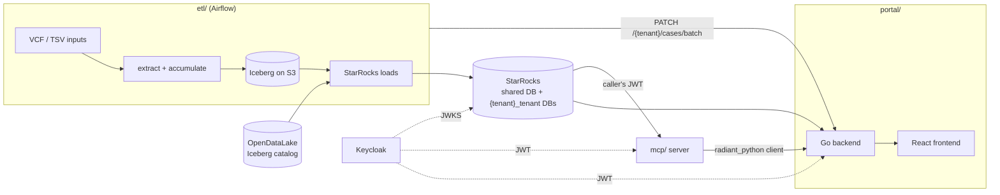

# Architecture overview

## Components

- **ETL** (`etl/`): Airflow DAGs. Parses VCFs, writes Iceberg tables, loads StarRocks, computes frequencies, and imports open data. It also runs the Nextflow post-processing and QC automations, then registers their outputs on cases through the portal API.
- **StarRocks**: the analytics store the portal and the MCP read. Shared tables (open data, cross-tenant) live in the base DB. Per-tenant tables live in `{tenant}_tenant`. Details: [contracts/starrocks-schema.md](../contracts/starrocks-schema.md).
- **Portal** (`portal/`): Go REST API (plus an async batch worker) and a React frontend. Its OpenAPI spec is the API contract: [contracts/portal-api.md](../contracts/portal-api.md).
- **MCP** (`mcp/`): exposes StarRocks query tools and some portal-API tools to LLM clients. It holds no StarRocks credentials. Every query runs under the caller's Keycloak JWT, which StarRocks validates itself.
- **Keycloak**: the identity provider for the portal, the MCP and StarRocks.

## Deployment

TODO: summarise the QA/prod topology (EKS, MWAA/ECS vs k8s operators, StarRocks) from `infra/*`.
