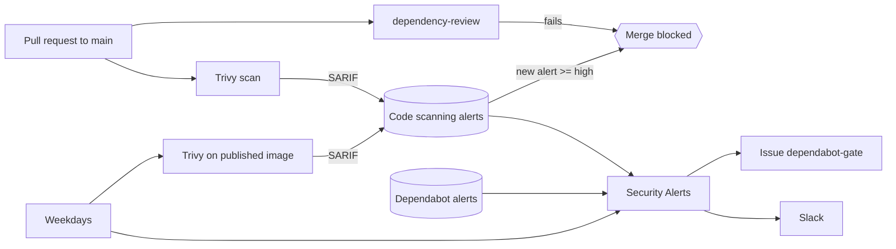

# Security checks in CI

Which GitHub Actions check the security of the Radiant repos, when they run, what blocks a merge and who gets notified. Ticket: [RAD-183](https://ferlab-crsj.atlassian.net/browse/RAD-183).

| Repo | Status |
|---|---|
| radiant-mcp | In place |
| radiant-portal | In place (thresholds per ecosystem, 6 images) |
| radiant-portal-pipeline (etl) | In place (4 images) |
| infra, bioinfo | Not covered |

## Overview

Two different questions:

- **Does this PR add a vulnerability?** `dependency-review` and Trivy answer it, on the PR, and block the merge.
- **Which vulnerabilities are already on `main`?** The daily Security Alerts job answers it, in an issue and on Slack. It never blocks a merge, so a PR that fixes a vulnerability is never blocked by the vulnerability it fixes.

## Workflows

| Workflow (file) | Runs | Checks | Blocks merge | Notifies |
|---|---|---|---|---|
| Dependency Review (`dependency-review.yml`) | Every PR to `main` | Dependencies the PR **adds or bumps**, against the GitHub Advisory Database. mcp and etl: fails at or above `fail-on-severity`. Portal: the action runs in `warn-only` and a second step fails at or above the threshold of each ecosystem (`THRESHOLDS`). Lower severities are listed in the job summary. | Yes, required status check `dependency-review` | No |
| Trivy (`trivy.yml`) | PR to `main`, push to `main` | The images built from the Dockerfiles (OS packages, installed packages, binaries bundled in wheels) and the Dockerfile configuration (e.g. root user). Only vulnerabilities with a fix (`ignore-unfixed`). The etl scans its 4 images (airflow, task operator, dbt, Nextflow launcher) in parallel. The portal scans its 6 images in parallel, each one twice: OS packages and application packages, with their own severity. | Yes, if the PR adds a high or critical alert (ruleset rule *Require code scanning results*) | No. Results in Security → Code scanning and in the PR's `Trivy` check |
| Trivy (`trivy.yml`) | Weekdays 11:00 UTC, manual | The images published on ghcr with the `latest` tag, to catch vulnerabilities disclosed after they were built | No | No. Updates the code scanning alerts of `main` |
| Security Alerts (`dependabot-alerts.yml`) | Weekdays 11:30 UTC, manual | Open alerts of `main`: Dependabot at or above `DEPENDABOT_THRESHOLDS`, Trivy at `TRIVY_SEVERITIES` | No | Yes: issue labelled `dependabot-gate` (created, updated, closed when empty) and a Slack message while alerts remain. In the etl, each list of the issue is cut to fit GitHub's 65536-character limit, critical first, with a link to the Security tab for the rest |

11:00 UTC is 7:00 in Montréal during daylight saving time, 6:00 otherwise.

Dependabot itself (not a workflow) raises the alerts as soon as an advisory is published; they are listed in Security → Dependabot. **Dependabot security updates** (automatic fix PRs) are deliberately off: fixes are made by hand, in a normal PR that goes through the same checks.

## Thresholds

| Source | Blocks / reports at | Where it is set |
|---|---|---|
| Python (mcp, etl) | high, critical | `fail-on-severity` in `dependency-review.yml`, `DEPENDABOT_THRESHOLDS` in `dependabot-alerts.yml` |
| Go (portal backend) | high, critical | `THRESHOLDS` (`gomod`) in `dependency-review.yml`, `DEPENDABOT_THRESHOLDS` in `dependabot-alerts.yml` |
| npm (portal frontend) | critical | same, `npm` |
| Python (portal, generated client `cli/python`) | high, critical | same, `pip`. The client only declares minimum versions: the installed versions are checked in the consumers' lockfiles (e.g. mcp's `uv.lock`) |
| Trivy, OS packages and Dockerfiles | high, critical, with a fix available | `severity` / `ignore-unfixed` in `trivy.yml`, ruleset rule, `TRIVY_SEVERITIES` |
| Trivy, application packages | high, critical; **critical** for the npm packages of the portal frontend image, to match `dependency-review` | `library-severity` in the matrix of the portal's `trivy.yml` |

The code scanning rule has a single threshold for all Trivy alerts (High or higher). A lower bar for one package type is set at scan time: Trivy only uploads what passes its `severity`, so what it filters out can never block.

## Protection of `main`

radiant-mcp: ruleset `main` (Settings → Rules → Rulesets). radiant-portal and radiant-portal-pipeline: ruleset `security-checks`, on top of the classic branch protection (which requires `build` in the portal, `run-tests` in the etl). All have:

- mcp only: pull request required (squash or rebase), no deletion, no force push.
- Required status check `dependency-review` (GitHub Actions only, the branch does not need to be up to date).
- Require code scanning results: tool `Trivy`, security alerts **High or higher**, other alerts none. Only alerts that the PR adds count, compared with the last analysis of `main`. The rule needs results for every category on each PR, so every image is scanned on every PR.
- No bypass actor: an admin cannot merge a PR that fails either rule.

## When a PR is blocked

- **dependency-review fails**: bump the dependency to the fixed version shown in the job summary. If no fix exists and the risk is accepted, add the advisory to `allow-ghsas` in `dependency-review.yml`, with a comment saying why.
- **Trivy blocks**: open the `Trivy` check of the PR. Bump the base image or the package. For a false positive or an accepted risk, dismiss the alert in Security → Code scanning ("won't fix" or "false positive") with a comment.

## Credentials

| Credential | Used by | Why |
|---|---|---|
| GitHub App `radiant-dependabot-alerts` (Dependabot alerts: read). Org variable `DEPENDABOT_APP_CLIENT_ID` (mcp) or org secret `DEPENDABOT_APP_ID` (portal, etl, deprecated `app-id` input), org secret `DEPENDABOT_APP_PRIVATE_KEY` | Security Alerts | The `GITHUB_TOKEN` gets HTTP 403 on the Dependabot alerts API |
| `GITHUB_TOKEN` (`issues: write`, `security-events: read` / `write`) | Security Alerts (issue, code scanning alerts), Trivy (SARIF upload) | |
| `SLACK_SECURITY_WEBHOOK` (org secret) | Security Alerts | Incoming webhook of the `cqgc` Slack app. The workspace has reached its app limit, so add webhooks to `cqgc` rather than creating an app |
| GitHub App `radiant-release-please` (contents, pull requests, issues: write). Org variable `RELEASE_PLEASE_APP_CLIENT_ID`, org secret `RELEASE_PLEASE_APP_PRIVATE_KEY` | Release Please (not a security check) | Tags and PRs created with the `GITHUB_TOKEN` don't trigger other workflows |

A new repo gets these by installing each App on it (Organization settings → GitHub Apps → Configure → Repository access) and adding it to the access list of each org secret and variable. Creating an App does not install it.

## Prerequisites per repo

- Dependency graph enabled (Settings → Code security). Without it, `dependency-review` fails on every PR.
- The Apps installed and the org secrets shared, as above.
- A first Trivy analysis on `main` (the push after merging `trivy.yml` does it) before enabling the code scanning rule, otherwise every existing alert counts as new.
