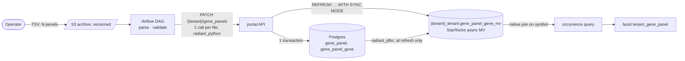
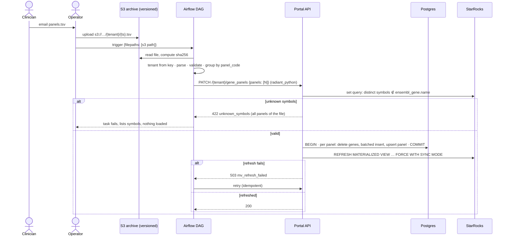
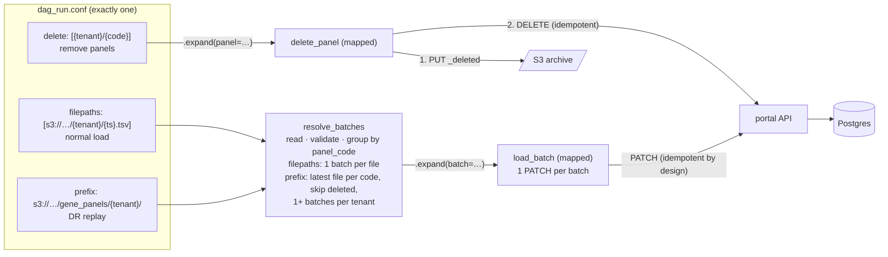
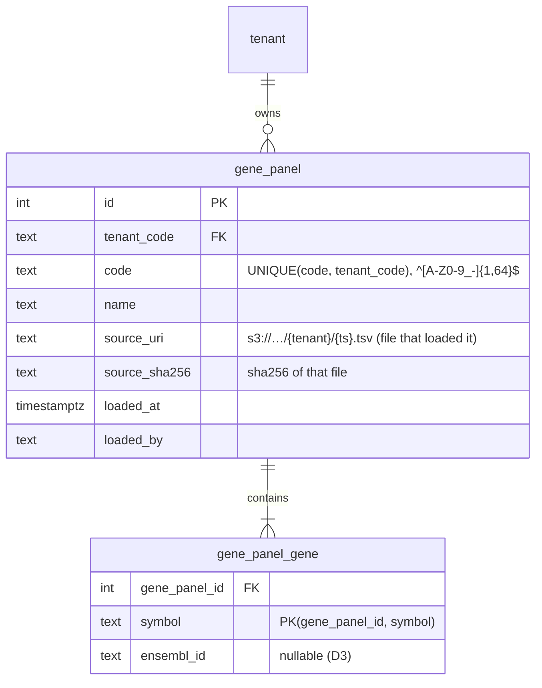
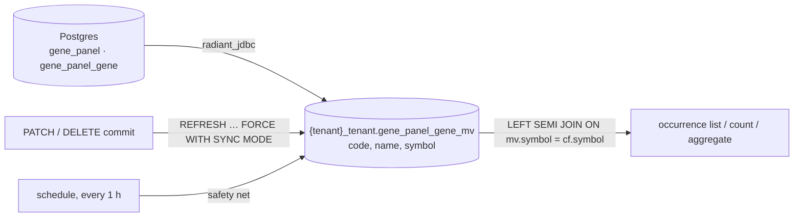
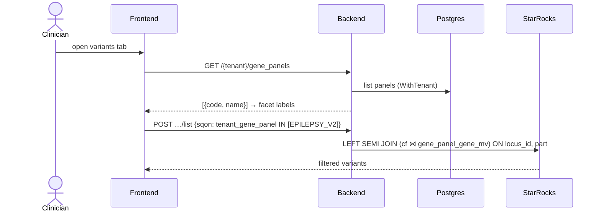

# RAD-10: Filter variants by gene panels

- **Status:** Draft
- **Branch (all repos):** `feat/rad-10-filter-variants-by-gene-panels`

## Context

Clinicians define gene panels: sets of genes that focus the analysis of a health condition. They want a facet on the variant exploration page that filters by these panels. Today the page has facets only for public panels (HPO, Orphanet, OMIM, DDD, COSMIC).

| Item | Content |
|---|---|
| Reviewer | • Jeremy Costanza |
| Acceptance criteria | • **AC1:** operators load panels into a tenant from a `.tsv` file. Clinicians send the file by email.<br>• **AC2:** a portal facet filters variants by these panels.<br>• **AC3:** panels are persistent. A panel is available in later sessions and on other cases. |
| Rules | • Each panel belongs to one tenant.<br>• Every user of the tenant who has permission can use all of its panels, in all organizations.<br>• The raw `.tsv` is archived in S3 for disaster recovery (DR). |
| Out of scope | • CNV filtering.<br>• Self-service panel management.<br>• A UI to browse the panels.<br>• Download of the `.tsv` files. |

The design choices and the options considered are in [Appendix A](#appendix-a-options-considered). The decisions taken so far are in the [decision log](#decision-log).

**Integration point:** the new filter reuses the existing gene panel join. A panel filter on SNV occurrences is a `LEFT SEMI JOIN` on `snv__consequence_filter_partitioned.symbol` (`portal/backend/internal/repository/starrocks/snv_occurrences.go:62-107`). The new MV plugs into this join, the same way as the public panels (HPO, OMIM, …). The rest of the current system does not change.

**Target:**



## Modules impacted

| Module | Impact |
|---|---|
| etl | • New DAG `import_tenant_gene_panel`, with three modes:<br>&nbsp;&nbsp;◦ normal load: one or more files. S3 → parse → validate → **one `PATCH` per file**;<br>&nbsp;&nbsp;◦ DR replay: an S3 prefix. One `PATCH` per tenant, split by size;<br>&nbsp;&nbsp;◦ delete: a list of `{tenant}/{code}`. Writes a `_deleted` marker to S3, then calls `DELETE`.<br>• New dependency: `radiant_python`, pinned to a commit. |
| portal (backend) | • Migration: tables `gene_panel` and `gene_panel_gene`, action `can_manage_gene_panel`.<br>• New endpoints: `PATCH /{tenant}/gene_panels`, `DELETE /{tenant}/gene_panels/{code}`, `GET /{tenant}/gene_panels`.<br>• Batched inserts, set-based symbol check against `ensembl_gene`, request body limit.<br>• New per-tenant MV `gene_panel_gene_mv`: create it, refresh it after each write.<br>• New SQON field `tenant_gene_panel` for germline and somatic SNV.<br>• Regenerate the Python and TS clients. |
| portal (frontend) | • New facet `tenant_gene_panel` in the germline and somatic configs.<br>• Label map `code → name`.<br>• en/fr labels. |
| mcp | • Bump the client SHA.<br>• Update the prompt doc.<br>• Optional: a tool that lists the panels. |
| infra | • S3 archive prefix, with versioning.<br>• IAM for the Airflow role on the archive prefix:<br>&nbsp;&nbsp;◦ `s3:ListBucket` and `s3:GetObject` (load, replay);<br>&nbsp;&nbsp;◦ `s3:PutObject` (delete marker).<br>• Grant `can_manage_gene_panel` to the existing ETL service account.<br>• StarRocks:<br>&nbsp;&nbsp;◦ Ranger read grants on the MVs for the portal users (proxy read);<br>&nbsp;&nbsp;◦ privileges for the backend service user to create and refresh the MVs. |

## Contract changes

Every change to a boundary (StarRocks table/column, enum value, API endpoint/field). For each: the writer, the readers, and the matching update to `docs/contracts/`.

| Contract | Change | Writer | Readers |
|---|---|---|---|
| Portal API<br>(`docs/contracts/portal-api.md`) | • New `PATCH /{tenant}/gene_panels`, `DELETE /{tenant}/gene_panels/{code}`, `GET /{tenant}/gene_panels`.<br>• New SQON field `tenant_gene_panel` on germline/somatic SNV `list`, `count` and `aggregate`. Its values are panel codes.<br>• New action `can_manage_gene_panel`. | • portal backend | • etl<br>• portal frontend<br>• mcp |
| Portal API consumers<br>(`docs/contracts/portal-api.md`) | • ETL row: add "`radiant_python`, pinned SHA, for `/gene_panels`".<br>• The batch and case group calls stay "hand-written, manual". | • etl | — |
| StarRocks schema<br>(`docs/contracts/starrocks-schema.md`) | • New per-tenant async MV `{tenant}_tenant.gene_panel_gene_mv(code, name, symbol)`.<br>• Built from `radiant_jdbc.public.gene_panel` and `gene_panel_gene`. | • portal backend (DDL and refresh, next to `internal/repository/starrocks/starrocks_tenant.go`) | • portal backend<br>• mcp |
| S3 layout<br>(new, record it in `docs/contracts/`) | • Versioned bucket.<br>• `…/gene_panels/{tenant}/{ts}.tsv`: panel file. It holds one or more panels.<br>• `…/gene_panels/{tenant}/_deleted/{code}`: logical delete marker for one panel.<br>• File format:<br>&nbsp;&nbsp;◦ tab-separated, UTF-8, header row, CRLF allowed;<br>&nbsp;&nbsp;◦ columns: `panel_code`, `panel_name`, `symbol`, and optionally `ensembl_id`;<br>&nbsp;&nbsp;◦ one row per gene;<br>&nbsp;&nbsp;◦ `panel_name` is the same on every row of a code. | • operator: the `.tsv` files<br>• etl: the `_deleted` marker | • etl (`import_tenant_gene_panel`): the tenant from the key, the panel codes from the file |

## Per-module plan

### etl

**Load flow (AC1, AC3):**



**One DAG, three input modes:**



**DAG `import_tenant_gene_panel`, conf** (exactly one param; if more than one is set, or none, the DAG fails at the first task):

| Param | Use |
|---|---|
| `filepaths` | • A list of S3 objects, for a normal load. |
| `prefix` | • An S3 prefix, for a DR replay.<br>• One tenant: `…/gene_panels/{tenant}/`. All tenants: `…/gene_panels/`. |
| `delete` | • A list of `{tenant}/{code}`, to remove panels. |

**DAG tasks:**

| Task | Behaviour |
|---|---|
| `resolve_batches` | • Reads the tenant from the S3 key (`…/gene_panels/{tenant}/{ts}.tsv`). A key with another layout fails the run.<br>• Reads each file with `boto3` (`radiant/tasks/utils.py:71-90`) and computes the file `sha256`.<br>• Parses and validates each file. If one rule fails, the whole run fails before any API call:<br>&nbsp;&nbsp;◦ the header has the required columns;<br>&nbsp;&nbsp;◦ `panel_code` matches `^[A-Z0-9_-]{1,64}$`;<br>&nbsp;&nbsp;◦ `panel_name` is the same on every row of a code;<br>&nbsp;&nbsp;◦ `symbol` is not empty;<br>&nbsp;&nbsp;◦ no symbol appears twice in one panel;<br>&nbsp;&nbsp;◦ with `filepaths`, no code appears in two files of the same run.<br>• Groups the rows by `panel_code`. Each panel becomes `{code, name, genes, source_uri, source_sha256}`.<br>• With `filepaths`: **one batch per file**, with all the panels of that file. One call per file keeps the file atomic.<br>• With `prefix`:<br>&nbsp;&nbsp;◦ lists all files. For each code, keeps the panel from the **latest file that contains that code**, by S3 `LastModified`;<br>&nbsp;&nbsp;◦ skips a code when `_deleted/{code}` is newer than that file. So a panel that is loaded again after a delete comes back on replay;<br>&nbsp;&nbsp;◦ groups the kept panels by tenant. Splits a tenant into several batches above **100,000 genes** (about 5 MB of JSON). A replay does not need one transaction for the whole tenant;<br>&nbsp;&nbsp;◦ uses the boto3 paginator: [ListObjectsV2](https://docs.aws.amazon.com/AmazonS3/latest/API/API_ListObjectsV2.html) returns `LastModified` for each object, and at most 1,000 keys per call.<br>• `_deleted/{code}` is a logical marker. It is not the [S3 delete marker](https://docs.aws.amazon.com/AmazonS3/latest/userguide/Versioning.html). |
| `load_batch` | • Mapped with `.expand()` ([dynamic task mapping](https://airflow.apache.org/docs/apache-airflow/stable/authoring-and-scheduling/dynamic-task-mapping.html)): one task instance per batch. The ETL already uses this pattern (`radiant/dags/import_part.py:364-369`).<br>• Calls `PATCH /{tenant}/gene_panels` once.<br>• Airflow retries a 503 `mv_refresh_failed`. The retry is safe (see the API section). |
| `delete_panel` | • Mapped with `.expand()`: one task instance per panel.<br>• Step 1: writes `…/{tenant}/_deleted/{code}` to S3 (body: `{deleted_at, dag_run_id}`). S3 comes before the DB, the same as for a load.<br>• Step 2: calls `DELETE /{tenant}/gene_panels/{code}` with `radiant_python`.<br>• Treats 404 as success: the panel is already gone, for example after a retry.<br>• Does not delete the `.tsv` files. They stay in S3 for audit. |

**Other etl changes:**

| Item | Change |
|---|---|
| DR | • The replay is the second restore path. The first one is the Postgres backup (see Open questions). |
| Client (H2) | • Pin `radiant-python-cli @ git+…radiant-portal.git@<sha>#subdirectory=cli/python`. This is the same pin as in `mcp/pyproject.toml:13` ([uv git sources](https://docs.astral.sh/uv/concepts/projects/dependencies/)).<br>• Add it to `requirements.txt` and `mwaa/airflow{2,3}/requirements-deps.txt`.<br>• The MWAA builder needs:<br>&nbsp;&nbsp;◦ GitHub access;<br>&nbsp;&nbsp;◦ `git`: add `dnf install git` if the "Development Tools" group does not include it.<br>• A small adapter gets the token with `fetch_token` and passes it as `access_token`. The generated client has no `client_credentials` flow (`portal/cli/python/radiant_python/configuration.py:179,495-501`). |
| `portal.py` | • No change.<br>• A follow-up ticket moves its calls to the generated client. |
| Runbook | • `radiant/dags/docs/import_tenant_gene_panel.md`.<br>• A conf example for each of the three modes. |

**etl tests:**

| Scope | Tests |
|---|---|
| DAG unit tests (`tests/unit/dags/`) | • Param validation: exactly one of `filepaths`, `prefix` or `delete`.<br>• `resolve_batches`:<br>&nbsp;&nbsp;◦ one batch per file with `filepaths`;<br>&nbsp;&nbsp;◦ replay: latest file per code, skips a code whose marker is newer, keeps a code loaded again after a delete;<br>&nbsp;&nbsp;◦ replay: splits a tenant above 100,000 genes;<br>&nbsp;&nbsp;◦ rejects a bad key layout.<br>• `load_batch`: retries on 503.<br>• `delete_panel`: marker written before the API call, 404 treated as success. |
| Parser | • Header, CRLF, empty lines.<br>• Bad `panel_code`.<br>• `panel_name` that differs within one code.<br>• Duplicate symbol in a panel.<br>• The same code in two files of one run. |
| Client | • Client call mocked.<br>• `tests/unit/nextflow/test_portal.py` still passes. |

### portal

**Data model (backend, new migration):**

| Item | Content |
|---|---|
| Why new tables | • Separate tables, so that the prescription `panel` does not change.<br>• `panel` is the prescription panel: `analysis_catalog.panel_id` references it (migration `000001:2028`). |
| Reads | • Use `.Scopes(postgres.WithTenant(ctx))`.<br>• This scope is a no-op when no tenant is bound (`portal/backend/CLAUDE.md:165`). |
| Writes | • Take `tenant_code` from `GetTenant(c)`.<br>• Put `tenant_code = ?` explicitly in each delete and upsert. |



**API (backend):**

| Route | Action | Behaviour | Result |
|---|---|---|---|
| `PATCH /{tenant}/gene_panels` | • New `can_manage_gene_panel` (tenant scope) | • Body: `{panels: [{code, name, genes: [{symbol, ensembl_id?}], source_uri, source_sha256}]}`.<br>• Replaces each listed panel by `code`. The panels that are not in the body do not change (E1).<br>• All panels of the request are written in **one transaction**.<br>• Idempotent by design. PATCH is "neither safe nor idempotent" in general, but "can be issued in such a way as to be idempotent" ([RFC 5789 §2](https://www.rfc-editor.org/rfc/rfc5789.html)). Replace-by-code makes the same body give the same state, so retries and replays are safe.<br>• Same pattern as `PATCH /{tenant}/cases/batch`. That one is async, through the worker. This one is sync, because the work takes seconds. | • 200.<br>• 400: a `code` does not match `^[A-Z0-9_-]{1,64}$`.<br>• 413: the body is too large.<br>• 422 `{unknown_symbols: {<code>: […]}}`. No panel is written.<br>• 503 `mv_refresh_failed`. Postgres is committed, the MV is stale. A retry is safe. |
| `DELETE /{tenant}/gene_panels/{code}` | • `can_manage_gene_panel` | • Deletes the panel, then refreshes the MV.<br>• Idempotent ([RFC 9110 §9.2.2](https://httpwg.org/specs/rfc9110.html#idempotent.methods)). | • 204.<br>• 404: the panel does not exist.<br>• 503 `mv_refresh_failed`. |
| `GET /{tenant}/gene_panels` | • `can_search_case` | • Reads from Postgres. | • `[{code, name, gene_count, loaded_at}]` |
| Germline/somatic SNV `list`, `count`, `aggregate` | • `can_search_case` (no change) | • New SQON field `tenant_gene_panel`. | • No change. |

| Item | Change |
|---|---|
| Action | • Seed the action in the migration. Migration `000018` seeds actions the same way. |
| Enforcement test | • Add each route to `cmd/api/action_enforcement_integration_test.go`. |

**Write path, efficiency:**

| Item | Content |
|---|---|
| Size | • A panel can hold up to about 20,000 genes: Ensembl 116 counts 19,878 coding genes for GRCh38 ([Ensembl 116](https://jun2026.archive.ensembl.org/Homo_sapiens/Info/Annotation)).<br>• One gene is about 50 bytes of JSON. A 5,000-gene panel is about 250 KB. A 20,000-gene panel is about 1 MB. |
| HTTP | • The QA ALB quotas limit only the headers (64 KB for the request header), not the body ([ALB quotas](https://docs.aws.amazon.com/elasticloadbalancing/latest/application/load-balancer-limits.html)). The QA ALB is in `qlin-qa-infra/terraform/kubernetes_config/ingress_class.tf`.<br>• The backend has no server-side body limit today. Add `http.MaxBytesReader` on this route (for example 50 MB), and return 413 above it.<br>• Prod infra is not verified. |
| Inserts | • Use GORM `CreateInBatches`, for example 1,000 rows per statement ([GORM batch insert](https://gorm.io/docs/create.html)).<br>• Do not insert one row at a time. |
| Symbol check | • One set query per chunk: `SELECT name FROM ensembl_gene WHERE name IN (…)`, with the distinct symbols of the request, in chunks of 1,000.<br>• Return all unknown symbols of the request, grouped by code. |

**Read path, B4: async materialized view:**



DDL, one MV per tenant:

```sql
CREATE MATERIALIZED VIEW IF NOT EXISTS {tenant}_tenant.gene_panel_gene_mv
DISTRIBUTED BY HASH(symbol)
REFRESH ASYNC EVERY (INTERVAL 1 HOUR)
AS
SELECT gp.code, gp.name, g.symbol
FROM radiant_jdbc.public.gene_panel gp
JOIN radiant_jdbc.public.gene_panel_gene g ON g.gene_panel_id = gp.id
WHERE gp.tenant_code = '{tenant}';
```

| Item | Content |
|---|---|
| Support | • StarRocks supports async MVs on a JDBC catalog ([MV on external catalogs](https://docs.starrocks.io/docs/using_starrocks/async_mv/use_cases/data_lake_query_acceleration_with_materialized_views/)).<br>• `REFRESH ASYNC … EVERY` is the legacy form. Newer versions show it as `REFRESH SCHEDULE … EVERY` ([CREATE MATERIALIZED VIEW](https://docs.starrocks.io/docs/sql-reference/sql-statements/materialized_view/CREATE_MATERIALIZED_VIEW/)). |
| Creation | • The backend creates the MV in the same places as the tenant views, so that every tenant has one:<br>&nbsp;&nbsp;◦ at tenant creation (`internal/service/tenant.go:68`);<br>&nbsp;&nbsp;◦ at API startup when `VIEW_REFRESH_ON_STARTUP_ENABLED=true` (`cmd/api/view_refresh.go:17`);<br>&nbsp;&nbsp;◦ with `go run ./cmd/refresh-tenants`. |
| Refresh | • After each `PATCH` or `DELETE` commit: `REFRESH MATERIALIZED VIEW {tenant}_tenant.gene_panel_gene_mv FORCE WITH SYNC MODE` ([REFRESH MATERIALIZED VIEW](https://docs.starrocks.io/docs/sql-reference/sql-statements/materialized_view/REFRESH_MATERIALIZED_VIEW/)).<br>&nbsp;&nbsp;◦ `FORCE`: always refresh, even when StarRocks cannot detect the change.<br>&nbsp;&nbsp;◦ `WITH SYNC MODE`: the call returns only when the refresh succeeds or fails, so the API can return 503.<br>• Why the API must trigger it: a change in an external source cannot trigger the refresh. External MVs "only support asynchronous fixed-interval refresh and manual refresh" ([CREATE MATERIALIZED VIEW](https://docs.starrocks.io/docs/sql-reference/sql-statements/materialized_view/CREATE_MATERIALIZED_VIEW/)).<br>• Each refresh is a full refresh of the tenant's MV. Partition-level change detection on JDBC exists only for MySQL range-partitioned tables.<br>• Example size: 100 panels × 5,000 genes = 500,000 short rows. This is small.<br>• Refresh history: `information_schema.task_runs`. |
| Filter | • Add `TenantGenePanelTable{Name: "gene_panel_gene_mv", Alias: "tgp", PerTenant: true}` and `Field{Name: "code", Alias: "tenant_gene_panel", CanBeFiltered: true, CanBeAggregated: true}`:<br>&nbsp;&nbsp;◦ in `GenePanelsTables` (`internal/types/gene_panels.go:50`);<br>&nbsp;&nbsp;◦ in the germline and somatic field lists.<br>• `PerTenant` resolves to `{tenant}_tenant.gene_panel_gene_mv` only when the tenant is in the request context (`internal/types/table_field.go:26-35`). Check `TENANT_VIEWS_READ_ENABLED` in each environment.<br>• The field filters on `code`, not on `name`. The public panels filter on `panel`, which is their name (`internal/types/gene_panels.go`).<br>• The existing joins handle the field without change:<br>&nbsp;&nbsp;◦ semi-join: `internal/repository/starrocks/snv_occurrences.go:62-107`;<br>&nbsp;&nbsp;◦ aggregate join: `:123-140`. |

**Query flow (AC2, backend + frontend):**



**Other portal changes:**

| Item | Change |
|---|---|
| Clients | • `make doc` in `backend/`.<br>• `make generate-client-python` and `make generate-client-typescript` in `portal/`. |
| Frontend facet | • Add `{ key: 'tenant_gene_panel', translation_key: 'tenant_gene_panel', type: FilterTypes.MULTIPLE }` under `gene_divider`:<br>&nbsp;&nbsp;◦ `portals/radiant/config/radiant.ts:52-58` (somatic);<br>&nbsp;&nbsp;◦ `portals/radiant/config/radiant.ts:375-381` (germline).<br>• Add en/fr labels and a tooltip in `translations/common/{en,fr}.json`.<br>• The values come from `GET /gene_panels` (C2). |
| Frontend labels | • The facet shows `name` and sends `code`.<br>• Today a `MULTIPLE` facet labels a value from `common.facets.values.<key>.<value>`, and falls back to the raw key (`components/base/query-builder/facets/multiselect-facet.tsx:114-119`).<br>• Panel names are data, not translations. So the facet needs a label map `code → name` from `GET /gene_panels`. This is a small change to the facet component. |

**portal tests:**

| Scope | Tests |
|---|---|
| Postgres repository | • Tenant isolation.<br>• One transaction per request: a failure on panel N writes no panel. |
| Handlers | • 200, 400, 413, 403, 503.<br>• 422: all unknown symbols, grouped by code. |
| Authorization | • Action-enforcement test. |
| StarRocks | • The MV DDL renders per tenant.<br>• Filter and aggregate on `tenant_gene_panel`, with a fixture. |

### mcp

| Item | Change |
|---|---|
| Client | • Bump the `radiant-python-cli` SHA in `pyproject.toml:13`. |
| Prompt doc | • Add `{tenant}_tenant.gene_panel_gene_mv` to `librechat-local/agent-radiant-clinical.md`. |
| Tool (optional) | • A tool that lists the tenant panels. |

## Merge and rollout order

1. **portal backend**
   - Prerequisites (infra):
     - S3 prefix and IAM;
     - `can_manage_gene_panel` grant for the ETL service account;
     - StarRocks privileges and Ranger grants for the MV.
   - Migration, API, MV DDL and refresh, field.
   - Regenerated Python and TS clients.
2. **etl**
   - DAG `import_tenant_gene_panel`.
   - Client pinned to the merged backend SHA.
3. **portal frontend / mcp**
   - Facet.
   - Client SHA bump.

| Topic | Note |
|---|---|
| Order | • The API comes before the ETL, because the ETL calls the API.<br>• This is the reverse of the usual order. |
| Migrations | • They run at API startup (`cmd/api/main.go:377`). |
| MVs | • The MV must exist for every tenant before the field is used. Do one of:<br>&nbsp;&nbsp;◦ set `VIEW_REFRESH_ON_STARTUP_ENABLED=true` for the deploy (`cmd/api/view_refresh.go:17`);<br>&nbsp;&nbsp;◦ run `go run ./cmd/refresh-tenants` after the deploy. |
| StarRocks version | • Check that the deployed version supports async MVs on a JDBC catalog before step 1.<br>• `qlin-qa-infra` pins only the Terraform provider versions, not StarRocks. |
| Backfill | • None. |
| Feature flag | • None. The facet shows no values until a panel is loaded. |
| If the order is not respected | • Without step 1, the DAG gets 404.<br>• Without the grant, the DAG gets 403 (`portal.py:7-10`).<br>• Without the MV, the filter fails with "unknown table". |

## Open questions

| # | Topic | Question | Proposed |
|---|---|---|---|
| 1 | C | • List all panels, or only the panels with hits? | • C2: all panels |
| 2 | D | • Is there a sample file?<br>• Do the clinicians already use stable panel codes, or must the operator assign them? | — |
| 3 | F | • Reject unknown symbols, warn, or resolve aliases? | • F1: reject |
| 4 | G | • Germline only, or germline + somatic? | • G2: both |
| 5 | S3 | • Which bucket and prefix?<br>• Object lock? Retention? | — |
| 6 | Backup | • What is the Postgres backup policy?<br>• Is S3 replay a second DR path, or the only one? | — |
| 7 | StarRocks | • Which version is deployed in QA and prod?<br>• Does it support async MVs on JDBC? | — |
| 8 | Ownership | • Who maintains the panels, and how often?<br>• What is the facet label (en/fr)? | — |
| 9 | Follow-up | • Ticket number for the migration of `portal.py` to `radiant_python`. | — |

## Linked PRs

- etl:
- portal:
- mcp:

---

## Appendix A: Options considered

**A. Storage and ingestion** (A4 chosen, with A4-a as the ingestion path):

| | A1: ETL → per-tenant StarRocks | A2: ETL → shared StarRocks | A3: Postgres + toolbox | **A4: Postgres + portal API** ✅ |
|---|---|---|---|---|
| Source of truth | StarRocks | StarRocks | Postgres | Postgres. Raw TSV in S3 |
| Tenant isolation | Separate DB | `tenant_code` / Ranger | Tenant view | API action + per-tenant MV |
| Atomic replace | Needs a staging table | Needs a staging table | PG transaction | PG transaction (per file) |
| Validation | DAG SQL | DAG SQL | CLI | API, in one place |
| Path to self-service | Weak | Weak | Medium | Strong (add UI + role) |
| Query path | Native | Native | Federation | Native (MV, B4) |
| Main risk | Table missing for a tenant | Cross-tenant leak | Mixes with prescription `panel` | Larger scope, MV refresh |
| Effort | S | S | M | M–L |

**Other axes:**

| Axis | Option | Notes |
|---|---|---|
| H. Airflow → portal client | H1: extend the hand-written client | • Add a gene panel call to `portal.py`. Nothing new to install.<br>• Risk: the API is copied by hand. Drift is found only at run time. |
| | **H2: generated `radiant_python`** ✅ | • Generated client + `fetch_token` adapter.<br>• Git pin. The MWAA build needs git and GitHub access.<br>• Typed. Drift is visible at each client bump.<br>• Risk: not on an index. Each API change needs a regenerate and a SHA bump. |
| W. Write granularity | W1: one `PUT /{tenant}/gene_panels/{code}` per panel | • Each panel loads alone.<br>• Risk: a file can load partly. |
| | **W2: one `PATCH /{tenant}/gene_panels` per file** ✅ | • The file loads completely or not at all, in one transaction.<br>• One 422 lists all unknown symbols of the file.<br>• Cost: one bad panel blocks the file. The body is larger (a few MB). |
| B. Filter mechanics | B1: federated tenant view in `GenePanelsTables` | • Same behaviour as HPO/OMIM (any consequence symbol).<br>• Each query reads Postgres through JDBC. The [JDBC catalog](https://docs.starrocks.io/docs/data_source/catalog/jdbc_catalog/) doc does not describe predicate pushdown, so the cost is not known.<br>• Fallback if the MV is not possible. |
| | B2: resolve to `symbol IN (…)` | • Same behaviour (`cf.symbol`, `internal/types/consequence.go:105-111`).<br>• No federation, but up to 20,000 literals in each query. The aggregate needs a separate path. |
| | B3: join on `snv__variant.symbol` | • **Different** behaviour (picked consequence only).<br>• Not recommended. |
| | **B4: StarRocks async MV over `radiant_jdbc`** ✅ | • Native join. JDBC is read only at refresh time.<br>• StarRocks manages the refresh, with task history.<br>• Cost: a few seconds of staleness after a write. The refresh must be monitored.<br>• A copy written by the backend itself (`INSERT OVERWRITE … SELECT FROM radiant_jdbc`) gives the same result with more custom code. |
| C. Facet values | C1: aggregate | • Only the panels with hits. |
| | C2: `GET /gene_panels` | • All panels. A4 has this endpoint, so C2 costs little. |
| D. TSV format | **D1: `panel_code, panel_name, symbol`** ✅ | • Many panels in one file. |
| | D2: `symbol` + code and name in the conf | • One panel per file. |
| | D3: D1 or D2 + `ensembl_id` | • Keeps the panels stable when HGNC renames a symbol ([Bruford et al. 2020](https://doi.org/10.1038/s41588-020-0669-3)). |
| E. Updates | **E1: replace by code** ✅ | • Only the panels of the file change. |
| | E2: full replace per tenant | • The operator must always send all panels. |
| | E3: versions | • [S3 versioning](https://docs.aws.amazon.com/AmazonS3/latest/userguide/Versioning.html) gives part of E3. |
| F. Symbol check | F1: reject | • Proposed. |
| | F2: warn | • Risk: a clinician trusts a panel that has missing genes. |
| | F3: resolve aliases | • `ensembl_gene.alias` can be null. |
| | F4: dbt test after the load | • Can be added to F1–F3. |
| G. Pages | G1: germline SNV | — |
| | G2: germline + somatic SNV | • Same backend change for both. |

### Decision log

Each decision refers to an option in the tables above.

| Date | Decision | Consequence |
|---|---|---|
| 2026-10-01 | **A4-a**: Postgres + portal API | • The panels are stored in Postgres, and the portal API owns them.<br>• The operator puts the TSV in S3. An Airflow DAG calls the API. |
| 2026-10-01 | **H2**, for the new call only | • The DAG uses the generated `radiant_python` client.<br>• The existing calls in `etl/radiant/tasks/nextflow/portal.py` do not change. |
| 2026-10-01 | One DAG for load, DR and delete | • `import_tenant_gene_panel` takes `filepaths` (normal load), `prefix` (DR replay) or `delete` (remove panels).<br>• There is no separate restore DAG and no separate delete DAG. |
| 2026-10-01 | TSV format **D1**: many panels in one file | • Columns: `panel_code`, `panel_name`, `symbol`, and optionally `ensembl_id`.<br>• The S3 key gives only the tenant: `…/gene_panels/{tenant}/{ts}.tsv`. The file gives the panel codes.<br>• A file replaces only the panels that it contains (E1). The other panels of the tenant do not change. |
| 2026-10-01 | Panel code | • `code` is the stable ID of a panel in a tenant (`gene_panel.code`). It comes from the `panel_code` column.<br>• Format: `^[A-Z0-9_-]{1,64}$`. It is safe in a URL path and in an S3 key. The DAG and the API reject other values.<br>• The SQON filters on `code`. The facet shows `name`. A rename does not break the saved filters. |
| 2026-10-01 | **W2**: one API call per file | • `PATCH /{tenant}/gene_panels` loads all the panels of a file in one Postgres transaction. The file loads completely, or not at all.<br>• Inserts are batched. The symbol check runs as a set query, not one query per gene. |
| 2026-10-01 | Read path **B4**: StarRocks async MV | • One MV per tenant, `{tenant}_tenant.gene_panel_gene_mv`, built from Postgres through `radiant_jdbc`.<br>• The API refreshes it after each write. A scheduled refresh is the safety net.<br>• The filter joins a native StarRocks table. No JDBC read happens per query. |

## Appendix B: Risks

| Risk | Mitigation |
|---|---|
| • The deployed StarRocks version does not support async MVs on JDBC. | • Check before step 1.<br>• Fallback: B1 (federated view), or a backend-written copy. |
| • An MV refresh fails, so the filter uses stale genes. | • The API returns 503 and Airflow retries.<br>• The hourly scheduled refresh repairs it.<br>• Alert on failed runs in `information_schema.task_runs`. |
| • A file is larger than expected. | • Body limit with 413.<br>• Replay batches are capped at 100,000 genes. |
| • The client is not on an index. The git pin needs network access and git at MWAA build time. | • Build the wheel in the deps builder.<br>• Or publish to a private index. |
| • PG and S3 diverge. | • S3 is written before the API call.<br>• `source_sha256` check.<br>• Deletion marker. |
| • Two portal clients in the ETL until the follow-up ticket. | • Shared `fetch_token`.<br>• Follow-up ticket. |
| • The ETL service account gets a 403. | • Grant `can_manage_gene_panel` per tenant in the rollout. |
| • HGNC renames: an old panel loses some genes. | • F1 at load.<br>• D3.<br>• Re-check after each Ensembl update. |
| • Users confuse it with the prescription `panel`. | • Separate tables.<br>• UI label "Tenant gene panels". |

## Appendix C: References

- **Project files:** cited inline. Every path and line was checked on 2026-10-01 against `main` of each module.
- RFC 9110 §9.2.2, idempotent methods: <https://httpwg.org/specs/rfc9110.html#idempotent.methods>
- RFC 5789 §2, PATCH: <https://www.rfc-editor.org/rfc/rfc5789.html>
- StarRocks JDBC catalog: <https://docs.starrocks.io/docs/data_source/catalog/jdbc_catalog/>
- StarRocks async MVs on external catalogs: <https://docs.starrocks.io/docs/using_starrocks/async_mv/use_cases/data_lake_query_acceleration_with_materialized_views/>
- StarRocks CREATE MATERIALIZED VIEW: <https://docs.starrocks.io/docs/sql-reference/sql-statements/materialized_view/CREATE_MATERIALIZED_VIEW/>
- StarRocks REFRESH MATERIALIZED VIEW: <https://docs.starrocks.io/docs/sql-reference/sql-statements/materialized_view/REFRESH_MATERIALIZED_VIEW/>
- AWS ALB quotas: <https://docs.aws.amazon.com/elasticloadbalancing/latest/application/load-balancer-limits.html>
- Amazon S3 versioning: <https://docs.aws.amazon.com/AmazonS3/latest/userguide/Versioning.html>
- Amazon S3 ListObjectsV2: <https://docs.aws.amazon.com/AmazonS3/latest/API/API_ListObjectsV2.html>
- GORM batch insert: <https://gorm.io/docs/create.html>
- uv git dependencies: <https://docs.astral.sh/uv/concepts/projects/dependencies/>
- Airflow dynamic task mapping: <https://airflow.apache.org/docs/apache-airflow/stable/authoring-and-scheduling/dynamic-task-mapping.html>
- Ensembl 116, Homo sapiens annotation (19,878 coding genes): <https://jun2026.archive.ensembl.org/Homo_sapiens/Info/Annotation>
- Bruford EA et al. Guidelines for human gene nomenclature. *Nat Genet* 52, 754–758 (2020). [doi:10.1038/s41588-020-0669-3](https://doi.org/10.1038/s41588-020-0669-3)
