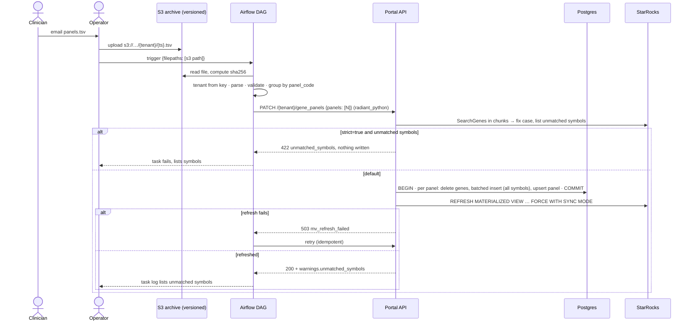
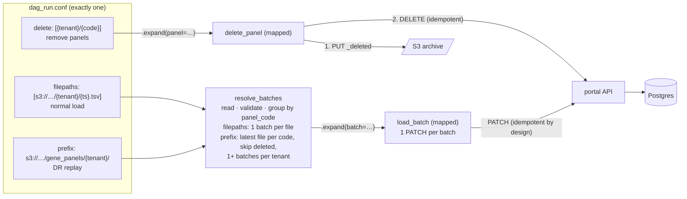
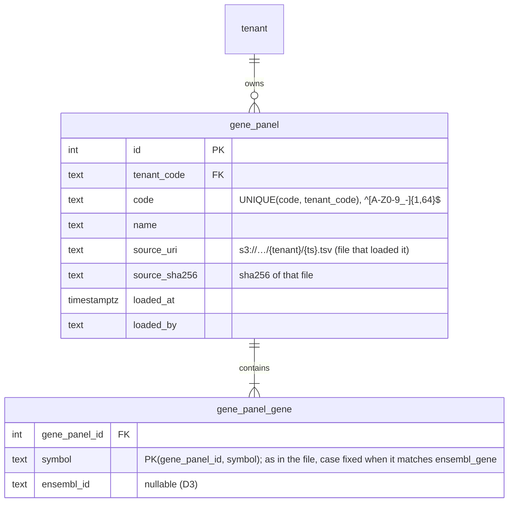
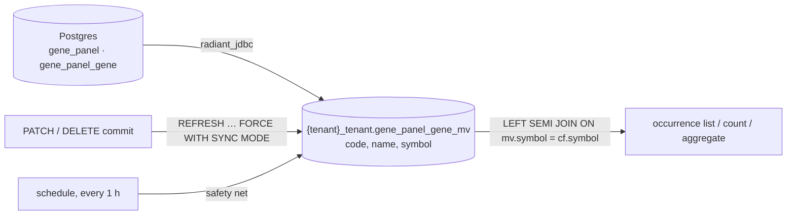
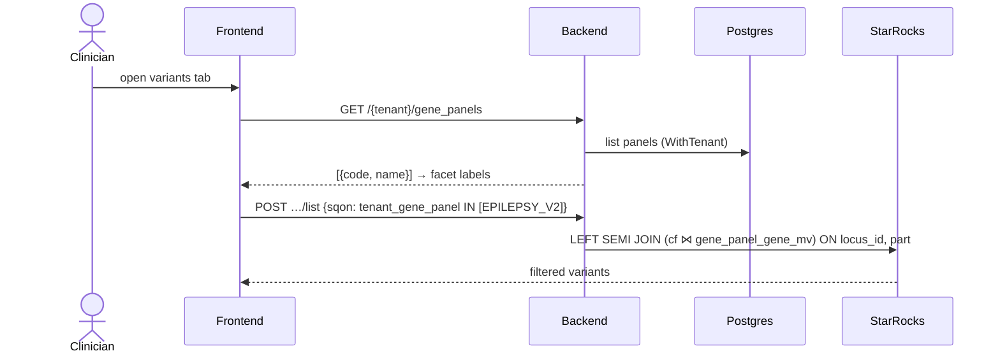
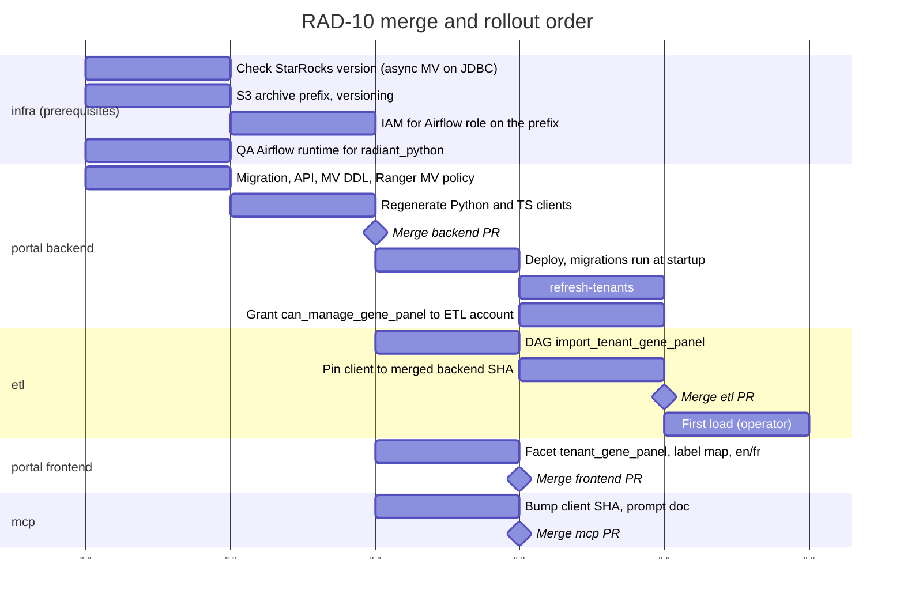

# RAD-10: Filter variants by gene panels

- **Status:** Draft
- **Branch (all repos):** `feat/rad-10-filter-variants-by-gene-panels`

## Context

Clinicians define gene panels: sets of genes that focus the analysis of a health condition. They want a facet on the variant exploration page that filters by these panels. Today the page has facets only for public panels (HPO, Orphanet, OMIM, DDD, COSMIC).

| Item | Content |
|---|---|
| Reviewer | • Jeremy Costanza |
| Acceptance criteria | • **AC1:** operators load panels into a tenant from a `.tsv` file. Clinicians send the file by email.<br>• **AC2:** a portal facet filters variants by these panels.<br>• **AC3:** panels are persistent. A panel is available in later sessions and on other cases. |
| Rules | • Each panel belongs to one tenant.<br>• Every user of the tenant who has permission can use all of its panels, in all organizations.<br>• The raw `.tsv` is archived in S3 for disaster recovery (DR). |
| Out of scope | • CNV filtering.<br>• Self-service panel management.<br>• A UI to browse the panels.<br>• Download of the `.tsv` files. |

The design choices and the options considered are in [Appendix A](#appendix-a-options-considered). The decisions taken so far are in the [decision log](#decision-log).

**Integration point:** the new filter reuses the existing gene panel join. A panel filter on SNV occurrences is a `LEFT SEMI JOIN` on `snv__consequence_filter_partitioned.symbol` (`portal/backend/internal/repository/starrocks/snv_occurrences.go:62-107`). The new MV plugs into this join, the same way as the public panels (HPO, OMIM, …). The rest of the current system does not change.

**Target:**


## Modules impacted

| Module | Impact |
|---|---|
| etl | • New DAG `import_tenant_gene_panel`, with three modes:<br>&nbsp;&nbsp;◦ normal load: one or more files. S3 → parse → validate → **one `PATCH` per file**;<br>&nbsp;&nbsp;◦ DR replay: an S3 prefix. One `PATCH` per tenant, split by size;<br>&nbsp;&nbsp;◦ delete: a list of `{tenant}/{code}`. Writes a `_deleted` marker to S3, then calls `DELETE`.<br>• New dependency: `radiant_python`, pinned to a commit. QA needs a runtime that has it (open question 10). |
| portal (backend) | • Migration: tables `gene_panel` and `gene_panel_gene`, action `can_manage_gene_panel` (seed, `DefaultRoles`, backfill of the existing tenants).<br>• Ranger: a `materialized_view` select policy per tenant in `EnsureTenantRangerConfig`.<br>• StarRocks calls of the write path (`SearchGenes`, `REFRESH`) on the root pool.<br>• New endpoints: `PATCH /{tenant}/gene_panels`, `DELETE /{tenant}/gene_panels/{code}`, `GET /{tenant}/gene_panels`.<br>• Batched inserts, request body limit.<br>• Symbol report against `ensembl_gene` (reuses `GenesRepository.SearchGenes`): it fixes the case and reports unmatched symbols. It does not reject them, unless `strict=true`.<br>• New per-tenant MV `gene_panel_gene_mv`: create it, refresh it after each write.<br>• New SQON field `tenant_gene_panel` for germline and somatic SNV (one table + one field; no new query code).<br>• `with_dictionary=true` on the aggregate pads all tenant panel codes.<br>• Regenerate the Python and TS clients. |
| portal (frontend) | • New facet `tenant_gene_panel` in the germline and somatic configs.<br>• Label map `code → name`.<br>• en/fr labels. |
| mcp | • Bump the client SHA.<br>• Update the prompt doc.<br>• Optional: a tool that lists the panels. |
| infra | • S3 archive prefix, with versioning. The QA datalake bucket has versioning on (`qlin-qa-infra/terraform/datalake/buckets.tf:1-7`).<br>• IAM for the Airflow role on the archive prefix:<br>&nbsp;&nbsp;◦ `s3:ListBucket` and `s3:GetObject` (load, replay);<br>&nbsp;&nbsp;◦ `s3:PutObject` (delete marker);<br>&nbsp;&nbsp;◦ the QA Airflow role already has List, Get and Put on the datalake bucket (`qlin-qa-infra/terraform/airflow/policies/airflow.json:84-104`). If the prefix goes there, no IAM change is needed.<br>• Grant `can_manage_gene_panel` to the existing ETL service account (Keycloak client `airflow` in QA, `qlin-qa-infra/terraform/keycloak_config/clients.tf:226-253`).<br>• QA Airflow runtime for `radiant_python` (open question 10).<br>• StarRocks:<br>&nbsp;&nbsp;◦ Ranger read on the MVs: done by the backend code and `cmd/refresh-tenants` (see the portal section);<br>&nbsp;&nbsp;◦ the backend user is `root`, so it can create and refresh the MVs. No change. |

## Contract changes

Every change to a boundary (StarRocks table/column, enum value, API endpoint/field). For each: the writer, the readers, and the matching update to `docs/contracts/`.

| Contract | Change | Writer | Readers |
|---|---|---|---|
| Portal API<br>(`docs/contracts/portal-api.md`) | • New `PATCH /{tenant}/gene_panels`, `DELETE /{tenant}/gene_panels/{code}`, `GET /{tenant}/gene_panels`.<br>• New SQON field `tenant_gene_panel` on germline/somatic SNV `list`, `count` and `aggregate`. Its values are panel codes.<br>• New action `can_manage_gene_panel`. | • portal backend | • etl<br>• portal frontend<br>• mcp |
| Portal API consumers<br>(`docs/contracts/portal-api.md`) | • ETL row: add "`radiant_python`, pinned SHA, for `/gene_panels`".<br>• The batch and case group calls stay "hand-written, manual". | • etl | — |
| StarRocks schema<br>(`docs/contracts/starrocks-schema.md`) | • New per-tenant async MV `{tenant}_tenant.gene_panel_gene_mv(code, name, symbol)`.<br>• Built from `radiant_jdbc.public.gene_panel` and `gene_panel_gene`. | • portal backend (DDL and refresh, next to `internal/repository/starrocks/starrocks_tenant.go`) | • portal backend<br>• mcp |
| S3 layout<br>(new, record it in `docs/contracts/`) | • Versioned bucket.<br>• `…/gene_panels/{tenant}/{ts}.tsv`: panel file. It holds one or more panels.<br>• `…/gene_panels/{tenant}/_deleted/{code}`: logical delete marker for one panel.<br>• File format:<br>&nbsp;&nbsp;◦ tab-separated, UTF-8, header row, CRLF allowed;<br>&nbsp;&nbsp;◦ columns: `panel_code`, `panel_name`, `symbol`, and optionally `ensembl_id`;<br>&nbsp;&nbsp;◦ one row per gene;<br>&nbsp;&nbsp;◦ `panel_name` is the same on every row of a code. | • operator: the `.tsv` files<br>• etl: the `_deleted` marker | • etl (`import_tenant_gene_panel`): the tenant from the key, the panel codes from the file |

## Per-module plan

### etl

**Load flow (AC1, AC3):**



**One DAG, three input modes:**



**DAG `import_tenant_gene_panel`, conf** (exactly one param; if more than one is set, or none, the DAG fails at the first task):

| Param | Use |
|---|---|
| `filepaths` | • A list of S3 objects, for a normal load. |
| `prefix` | • An S3 prefix, for a DR replay.<br>• One tenant: `…/gene_panels/{tenant}/`. All tenants: `…/gene_panels/`. |
| `delete` | • A list of `{tenant}/{code}`, to remove panels. |
| `strict` (optional, with `filepaths` or `prefix`) | • Default `false`: unmatched symbols are loaded and reported as warnings.<br>• `true`: the API rejects a batch that has unmatched symbols (422). Use it when the operator wants a clean match before the load. |

**DAG tasks:**

| Task | Behaviour |
|---|---|
| `resolve_batches` | • Reads the tenant from the S3 key (`…/gene_panels/{tenant}/{ts}.tsv`). A key with another layout fails the run.<br>• Reads each file with a streamed boto3 `get_object` and computes the file `sha256`. Do not use `download_s3_file` (`radiant/tasks/utils.py:71-90`): it writes the object to a local file.<br>• Parses and validates each file. If one rule fails, the whole run fails before any API call:<br>&nbsp;&nbsp;◦ the header has the required columns;<br>&nbsp;&nbsp;◦ `panel_code` matches `^[A-Z0-9_-]{1,64}$`;<br>&nbsp;&nbsp;◦ `panel_name` is the same on every row of a code;<br>&nbsp;&nbsp;◦ `symbol` is not empty;<br>&nbsp;&nbsp;◦ no symbol appears twice in one panel;<br>&nbsp;&nbsp;◦ with `filepaths`, no code appears in two files of the same run.<br>• Groups the rows by `panel_code`. Each panel becomes `{code, name, genes, source_uri, source_sha256}`.<br>• With `filepaths`: **one batch per file**, with all the panels of that file. One call per file keeps the file atomic.<br>• With `prefix`:<br>&nbsp;&nbsp;◦ lists all files. For each code, keeps the panel from the **latest file that contains that code**, by S3 `LastModified`. When two files have the same `LastModified`, the `{ts}` of the key decides;<br>&nbsp;&nbsp;◦ accepts the `{tenant}/_deleted/{code}` keys in the listing. They are not a bad layout;<br>&nbsp;&nbsp;◦ skips a code when `_deleted/{code}` is newer than that file. So a panel that is loaded again after a delete comes back on replay;<br>&nbsp;&nbsp;◦ groups the kept panels by tenant. Splits a tenant into several batches above **100,000 genes** (about 5 MB of JSON). A replay does not need one transaction for the whole tenant;<br>&nbsp;&nbsp;◦ uses the boto3 paginator: [ListObjectsV2](https://docs.aws.amazon.com/AmazonS3/latest/API/API_ListObjectsV2.html) returns `LastModified` for each object, and at most 1,000 keys per call.<br>• `_deleted/{code}` is a logical marker. It is not the [S3 delete marker](https://docs.aws.amazon.com/AmazonS3/latest/userguide/Versioning.html). |
| `load_batch` | • Mapped with `.expand()` ([dynamic task mapping](https://airflow.apache.org/docs/apache-airflow/stable/authoring-and-scheduling/dynamic-task-mapping.html)): one task instance per batch. The ETL already uses this pattern (`radiant/dags/import_part.py:365-369`).<br>• Takes the S3 key, the panel codes and the `sha256` from XCom, and parses the file again. Do not pass the genes through XCom: a batch is up to about 5 MB, and XCom is "only designed for small amounts of data" ([XComs](https://airflow.apache.org/docs/apache-airflow/stable/core-concepts/xcoms.html)).<br>• Sets `retries` on the task. `DEFAULT_ARGS` sets none (`radiant/dags/__init__.py:11`). Raises `AirflowFailException` on 400, 413 and 422, so they fail at once (pattern at `nextflow_postprocessing_cases.py:350-397`).<br>• Calls `PATCH /{tenant}/gene_panels` once, with `strict` from the conf.<br>• Logs the `warnings.unmatched_symbols` of the response, grouped by panel code.<br>• Airflow retries a 503 `mv_refresh_failed`. The retry is safe (see the API section). |
| `delete_panel` | • Mapped with `.expand()`: one task instance per panel.<br>• Step 1: writes `…/{tenant}/_deleted/{code}` to S3 (body: `{deleted_at, dag_run_id}`). S3 comes before the DB, the same as for a load.<br>• Step 2: calls `DELETE /{tenant}/gene_panels/{code}` with `radiant_python`.<br>• Treats 404 as success: the panel is already gone, for example after a retry.<br>• Does not delete the `.tsv` files. They stay in S3 for audit. |

**Other etl changes:**

| Item | Change |
|---|---|
| DR | • The replay is the second restore path. The first one is the Postgres backup (see Open questions).<br>• The replay only skips the deleted codes. It does not call `DELETE`. If Postgres is restored from a backup that still holds a deleted panel, the panel stays. Fix: the replay also calls `DELETE` for each code that has a `_deleted` marker newer than its latest file. |
| Client (H2) | • Pin `radiant-python-cli @ git+…radiant-portal.git@<sha>#subdirectory=cli/python`. This is the same pin as in `mcp/pyproject.toml:13`. It is a PEP 508 direct reference, not a uv source.<br>• **QA runtime (blocker):** QA does not run MWAA. It runs the stock `apache/airflow:3.2.1` image with the official Helm chart and the KubernetesExecutor, with no extra packages (`qlin-qa-infra/kubernetes-manifests/apps/airflow/helmrelease.yaml:1-3,41-44`). Choose one (open question 10):<br>&nbsp;&nbsp;◦ run the API tasks as a pod in the radiant-task-operator image (`Dockerfile.radiant.operator:10-11`);<br>&nbsp;&nbsp;◦ build a custom Airflow image;<br>&nbsp;&nbsp;◦ fall back to H1.<br>• **MWAA:**<br>&nbsp;&nbsp;◦ add it to `requirements.txt`, `mwaa/airflow{2,3}/requirements-deps.txt` **and** `requirements-mwaa.txt`. That file installs with `--no-index --find-links plugins` (`mwaa/airflow{2,3}/requirements-mwaa.txt:1-3`);<br>&nbsp;&nbsp;◦ add `dnf install -y git` to both builders. They run `uv pip compile` and `pip wheel` (`Dockerfile-mwaa-deps-builder:39-41`). The af2 and af3 build contexts are different;<br>&nbsp;&nbsp;◦ add a `radiant_api_conn` connection. Terraform defines only `starrocks_conn` and `testquality_conn` (`radiant-portal-deployment/deployment/terraform/airflow/main.tf:157,202`).<br>• The repo is public, so the git fetch needs no credentials.<br>• A small adapter gets the token with `fetch_token` (`portal.py:30-40`) and passes it as `access_token`. The generated client has no `client_credentials` flow (`portal/cli/python/radiant_python/configuration.py:179,495-501`). Reuse `radiant_api_conn` and `load_portal_connection` (`radiant/tasks/nextflow/register.py:16,30,33`). |
| `portal.py` | • No change.<br>• A follow-up ticket moves its calls to the generated client. |
| Runbook | • `radiant/dags/docs/import_tenant_gene_panel.md`.<br>• A conf example for each of the three modes. |

**etl tests:**

| Scope | Tests |
|---|---|
| DAG unit tests (`tests/unit/dags/`) | • Param validation: exactly one of `filepaths`, `prefix` or `delete`.<br>• `resolve_batches`:<br>&nbsp;&nbsp;◦ one batch per file with `filepaths`;<br>&nbsp;&nbsp;◦ replay: latest file per code, skips a code whose marker is newer, keeps a code loaded again after a delete;<br>&nbsp;&nbsp;◦ replay: splits a tenant above 100,000 genes;<br>&nbsp;&nbsp;◦ rejects a bad key layout.<br>• `load_batch`: retries on 503.<br>• `delete_panel`: marker written before the API call, 404 treated as success. |
| Parser | • Header, CRLF, empty lines.<br>• Bad `panel_code`.<br>• `panel_name` that differs within one code.<br>• Duplicate symbol in a panel.<br>• The same code in two files of one run. |
| Client | • Client call mocked.<br>• Warnings are logged. `strict=true` is passed through.<br>• `tests/unit/nextflow/test_portal.py` still passes. |

### portal

**Data model (backend, new migration):**

| Item | Content |
|---|---|
| Why new tables | • Separate tables, so that the prescription `panel` does not change.<br>• `panel` is the prescription panel: `analysis_catalog.panel_id` references it (migration `000001:2028`). |
| Reads | • Use `.Scopes(postgres.WithTenant(ctx))`.<br>• This scope is a no-op when no tenant is bound (`portal/backend/CLAUDE.md:165`). |
| Writes | • Take `tenant_code` from `GetTenant(c)`.<br>• Put `tenant_code = ?` explicitly in each delete and upsert. |



**API (backend):**

| Route | Action | Behaviour | Result |
|---|---|---|---|
| `PATCH /{tenant}/gene_panels` | • New `can_manage_gene_panel` (tenant scope) | • Body: `{panels: [{code, name, genes: [{symbol, ensembl_id?}], source_uri, source_sha256}]}`.<br>• Query param: `strict` (default `false`).<br>• Replaces each listed panel by `code`. The panels that are not in the body do not change (E1).<br>• All panels of the request are written in **one transaction**.<br>• Idempotent by design. PATCH is "neither safe nor idempotent" in general, but "can be issued in such a way as to be idempotent" ([RFC 5789 §2](https://www.rfc-editor.org/rfc/rfc5789.html)). Replace-by-code makes the same body give the same state, so retries and replays are safe.<br>• Same pattern as `PATCH /{tenant}/cases/batch`. That one is async, through the worker. This one is sync, because the work takes seconds. | • 200.<br>• 400: a `code` does not match `^[A-Z0-9_-]{1,64}$`.<br>• 413: the body is too large.<br>• 200 always lists `warnings: {unmatched_symbols: {<code>: […]}}`. All symbols are stored.<br>• 422 `{unmatched_symbols: {<code>: […]}}` only with `?strict=true`. No panel is written.<br>• 503 `mv_refresh_failed`. Postgres is committed, the MV is stale. A retry is safe. |
| `DELETE /{tenant}/gene_panels/{code}` | • `can_manage_gene_panel` | • Deletes the panel, then refreshes the MV.<br>• Idempotent ([RFC 9110 §9.2.2](https://httpwg.org/specs/rfc9110.html#idempotent.methods)). | • 204.<br>• 404: the panel does not exist.<br>• 503 `mv_refresh_failed`. |
| `GET /{tenant}/gene_panels` | • `can_search_case` | • Reads the list from Postgres.<br>• Computes `matched_count` **at read time** in StarRocks: `SELECT mv.code, count(DISTINCT mv.symbol) AS gene_count, count(DISTINCT eg.name) AS matched_count FROM {tenant}_tenant.gene_panel_gene_mv mv LEFT JOIN radiant.ensembl_gene eg ON eg.name = mv.symbol GROUP BY mv.code`. Take the shared database name from the `SharedDatabase` config, not a hard-coded `radiant`. `DISTINCT` is needed because `ensembl_gene` has one row per gene and chromosome (`DUPLICATE KEY(gene_id, chromosome)`).<br>• So the count follows each Ensembl update. No recheck job is needed. | • `[{code, name, gene_count, matched_count, loaded_at}]` |
| Germline/somatic SNV `list`, `count`, `aggregate` | • `can_search_case` (no change) | • New SQON field `tenant_gene_panel`. | • No change. |

| Item | Change |
|---|---|
| Action | • Seed the action in the migration. Copy `000032_seed_can_edit_case_action.up.sql`, not `000018`: migration `000019` changed the `action` columns (`description_en`, `name_en`, `name_fr`, `description_fr`).<br>• Add the action to `DefaultRoles` (`internal/repository/postgres/tenant.go:23-53`), so that new tenants get it.<br>• Backfill the existing tenants, like `000033_backfill_can_edit_case_all_tenants.up.sql`.<br>• Which role gets the action: open question 13.<br>• The authorization is Postgres RBAC (`action`, `role`, `role_action`) with the Keycloak JWT as identity. |
| StarRocks access of the caller | • In QA `STARROCKS_PROXY_READ_ENABLED=true` (`qlin-qa-infra/kubernetes-manifests/apps/radiant-api/deployment.yaml:168`). Each `/:tenant` route then queries StarRocks as the caller (`cmd/api/main.go:141-143`).<br>• `PATCH /gene_panels` is the first ETL route that queries StarRocks (`SearchGenes`, `REFRESH`). The ETL service account has no StarRocks user: users are created only by `EnsureJWTUser` (`starrocks_user.go`).<br>• Fix: run `SearchGenes` and `REFRESH` with `database.ContextWithRootPool` (`internal/database/routing.go:27-36`), or create the StarRocks user and Ranger role for the account (open question 11). |
| Enforcement test | • Add each route to `cmd/api/action_enforcement_integration_test.go`. |

**Write path, efficiency:**

| Item | Content |
|---|---|
| Size | • A panel can hold up to about 20,000 genes: Ensembl 116 counts 19,878 coding genes for GRCh38 ([Ensembl 116](https://jun2026.archive.ensembl.org/Homo_sapiens/Info/Annotation)).<br>• One gene is about 50 bytes of JSON. A 5,000-gene panel is about 250 KB. A 20,000-gene panel is about 1 MB. |
| HTTP | • The QA ALB quotas limit only the headers (64 KB for the request header), not the body ([ALB quotas](https://docs.aws.amazon.com/elasticloadbalancing/latest/application/load-balancer-limits.html)). The QA ALB is in `qlin-qa-infra/terraform/kubernetes_config/ingress_class.tf`.<br>• The backend has no server-side body limit today. Add `http.MaxBytesReader` on this route (for example 50 MB), and return 413 above it.<br>• Prod infra is not verified. |
| Inserts | • Use GORM `CreateInBatches`, for example 1,000 rows per statement ([GORM batch insert](https://gorm.io/docs/create.html)).<br>• Do not insert one row at a time. |
| Symbol report | • **Principle:** store the panel as the clinician defines it. Report what does not match today; do not reject it.<br>• **Why not reject:**<br>&nbsp;&nbsp;◦ `ensembl_gene` is a snapshot of one Ensembl release. A rejection would tie a valid panel to the release that the ETL loaded. A gene that is newer, or renamed in a later release, would be refused now and valid after the next import;<br>&nbsp;&nbsp;◦ a panel must never depend on the variants that exist at load time. The consequence set grows with each case, and a gene with no variant today can have variants tomorrow. The check uses only `ensembl_gene`, never the consequence tables.<br>• **Reference:** `ensembl_gene` (shared StarRocks DB, loaded by the ETL open data import). The symbol is in `name`; `gene_id` is the ENSG ID; `alias` can be null (`etl/radiant/dags/sql/open_data/init/ensembl_gene_create_table.sql`, `etl/radiant/data_qa/sources/ensembl_gene.yml:21-27`).<br>• **Reuse:** `GenesRepository.SearchGenes` already does this set query for the "upload a gene list" facet (`portal/backend/internal/repository/starrocks/genes.go:85-108`, route `POST /{tenant}/genes/search` at `cmd/api/main.go:181`):<br>&nbsp;&nbsp;◦ `SELECT gene_id, name FROM ensembl_gene WHERE UPPER(name) IN (…) OR UPPER(gene_id) IN (…)`;<br>&nbsp;&nbsp;◦ case-insensitive, and it also accepts ENSG IDs;<br>&nbsp;&nbsp;◦ it returns `[]GeneResult{GeneID, Name}`, with no link to the input. The caller maps each result back to the input by `UPPER(name)` or `UPPER(gene_id)`;<br>&nbsp;&nbsp;◦ `ensembl_gene` has one row per gene and chromosome, so the caller removes duplicates;<br>&nbsp;&nbsp;◦ an ENSG ID in the `symbol` column is stored as its `name`.<br>• **Steps in `PATCH`:**<br>&nbsp;&nbsp;◦ collect the distinct symbols of all panels in the request (trim spaces);<br>&nbsp;&nbsp;◦ call `SearchGenes` in chunks of 1,000 symbols: one query per chunk, not one per gene. A 20,000-symbol file is 20 queries on a small table;<br>&nbsp;&nbsp;◦ for a matched symbol, store the canonical `name` (for example `c1orf112` → `C1orf112`), so the join is exact;<br>&nbsp;&nbsp;◦ for an unmatched symbol, store it as in the file, and list it in `warnings.unmatched_symbols`;<br>&nbsp;&nbsp;◦ with `ensembl_id` in the file (D3), report a row whose ID maps to another `name`.<br>• **Visibility:** `GET /gene_panels` returns `gene_count` and `matched_count`. The frontend shows the gap next to the panel name.<br>• **Hard errors stay** only for invalid files: bad `panel_code`, empty symbol, duplicate symbol in a panel, bad layout (DAG checks).<br>• **Not done (F3):** no alias resolution. A previous HGNC symbol stays unmatched until the file is corrected.<br>• **Version:** matching uses the Ensembl release that the ETL loaded. If VEP annotated the variants with another release, some symbols can differ. Keep both releases aligned. |

**Read path, B4: async materialized view:**



DDL, one MV per tenant:

```sql
CREATE MATERIALIZED VIEW IF NOT EXISTS {tenant}_tenant.gene_panel_gene_mv
-- No "colocate_with": the group key is locus_id BIGINT, 10 buckets; this MV joins on symbol (see Performance, Colocation).
DISTRIBUTED BY HASH(symbol)
REFRESH ASYNC EVERY (INTERVAL 1 HOUR)
AS
SELECT gp.code, gp.name, g.symbol
FROM radiant_jdbc.public.gene_panel gp
JOIN radiant_jdbc.public.gene_panel_gene g ON g.gene_panel_id = gp.id
WHERE gp.tenant_code = '{tenant}';
```

| Item | Content |
|---|---|
| Support | • StarRocks supports async MVs on a JDBC catalog ([MV on external catalogs](https://docs.starrocks.io/docs/using_starrocks/async_mv/use_cases/data_lake_query_acceleration_with_materialized_views/)).<br>• `REFRESH ASYNC … EVERY` is the legacy form. Newer versions show it as `REFRESH SCHEDULE … EVERY` ([CREATE MATERIALIZED VIEW](https://docs.starrocks.io/docs/sql-reference/sql-statements/materialized_view/CREATE_MATERIALIZED_VIEW/)). |
| Creation | • The backend creates the MV in the same places as the tenant views, so that every tenant has one:<br>&nbsp;&nbsp;◦ at tenant creation, with the `cmd/create-tenant` CLI (`CreateTenant` calls `EnsureClinicalViews` at `internal/service/tenant.go:68`);<br>&nbsp;&nbsp;◦ at API startup when `VIEW_REFRESH_ON_STARTUP_ENABLED=true` (`cmd/api/view_refresh.go:17`);<br>&nbsp;&nbsp;◦ with `go run ./cmd/refresh-tenants`. |
| Refresh | • After each `PATCH` or `DELETE` commit: `REFRESH MATERIALIZED VIEW {tenant}_tenant.gene_panel_gene_mv FORCE WITH SYNC MODE` ([REFRESH MATERIALIZED VIEW](https://docs.starrocks.io/docs/sql-reference/sql-statements/materialized_view/REFRESH_MATERIALIZED_VIEW/)).<br>&nbsp;&nbsp;◦ `FORCE`: always refresh, even when StarRocks cannot detect the change.<br>&nbsp;&nbsp;◦ `WITH SYNC MODE`: the call returns only when the refresh succeeds or fails, so the API can return 503.<br>• Why the API must trigger it: a change in an external source cannot trigger the refresh. External MVs "only support asynchronous fixed-interval refresh and manual refresh" ([CREATE MATERIALIZED VIEW](https://docs.starrocks.io/docs/sql-reference/sql-statements/materialized_view/CREATE_MATERIALIZED_VIEW/)).<br>• Each refresh is a full refresh of the tenant's MV. Partition-level change detection on JDBC exists only for MySQL range-partitioned tables.<br>• Example size: 100 panels × 5,000 genes = 500,000 short rows. This is small.<br>• Refresh history: `information_schema.task_runs`. |
| Privileges | • The backend StarRocks user is `root` (`qlin-qa-infra/kubernetes-manifests/apps/radiant-api/deployment.yaml:142`). Root skips the Ranger checks, so create and refresh work.<br>• `radiant_jdbc` exists in QA. It uses the Postgres user `radiant` on database `radiant` (`qlin-qa-infra/kubernetes-manifests/apps/starrocks-init/configmap.yaml:19-24`). The same user runs the migrations, so the new tables are visible. |
| Ranger read (blocker) | • The Ranger plugin checks SELECT on an MV against the `materialized_view` resource (`RangerStarRocksAccessController.java:222-233`, StarRocks branch-4.0).<br>• `EnsureTenantRangerConfig` creates only a `table` and a `view` policy (`internal/service/ranger_masking.go:130-150`, `internal/client/admin_ranger.go:131-150`). With proxy read on, portal and MCP reads of the MV are denied.<br>• Fix: add a `materialized_view` select policy per tenant. Run `cmd/refresh-tenants` with Ranger credentials: the API startup refresh does not touch Ranger (`ranger_masking.go:153-157`). |
| Changes to the DDL | • There is no `CREATE OR REPLACE` for MVs. `IF NOT EXISTS` never applies a changed definition. A change needs `DROP` + `CREATE`, or `ALTER`.<br>• The startup refresh stops the API on error (`backend/CLAUDE.md:210`). A failed MV DDL stops the API from starting. |
| JDBC read cost | • The `tenant_code` filter is in the MV query, but the docs do not describe predicate pushdown. A refresh can read `gene_panel_gene` for all tenants. Put `tenant_code` on `gene_panel_gene`, or read a Postgres view per tenant. |
| Not verified | • Two concurrent `PATCH` calls that each run a SYNC refresh on the same MV.<br>• Changes to MVs in StarRocks 4.0.11 (QA). Only the 3.5 and latest docs were checked. |
| Filter | • See [Filter handling (backend)](#filter-handling-backend) below. |

#### Filter handling (backend)

The new filter adds **no new query code**. It adds one table and one field. The existing gene panel path then builds the SQL. Paths below are in `portal/backend/`.

**Type definitions** (in `internal/types/gene_panels.go`, next to the public panels):

```go
var TenantGenePanelTable = Table{
	Name:      "gene_panel_gene_mv", // {tenant}_tenant.gene_panel_gene_mv
	Alias:     "tgp",
	PerTenant: true,
}

var TenantGenePanelField = Field{
	Name:            "code",              // filter and group on the stable code
	Alias:           "tenant_gene_panel", // SQON field name
	CanBeFiltered:   true,
	CanBeAggregated: true,
	Table:           TenantGenePanelTable,
}

var GenePanelsTables = []Table{HpoGenePanelTable, OmimGenePanelTable, DddGenePanelTable,
	CosmicGenePanelTable, OrphanetGenePanelTable, TenantGenePanelTable} // + TenantGenePanelTable
```

- Add `TenantGenePanelField` to `GermlineSNVOccurrencesFields` (`internal/types/germline_snv_occurrence.go:328-340`, next to the public panel fields) and to the somatic list (`internal/types/somatic_snv_occurrence.go:238-242`).
- **Flag dependency:** with `TENANT_VIEWS_READ_ENABLED=false` (the code default), the bare name `gene_panel_gene_mv` resolves to `DB_NAME=radiant`. The MV does not exist there, so every query with the field fails. The public panels work there only because their tables exist in `radiant`. QA has the flag on (`qlin-qa-infra/kubernetes-manifests/apps/radiant-api/deployment.yaml:163`); D3b is not verified (open question 12). Accept the field only when the flag is on.
- `GenePanelsTables` is also used by the CNV paths (`internal/repository/starrocks/cnv_occurrences.go:28,72,126`). This has no effect while the field is not in the CNV field lists.

**Request handling, step by step:**

| Step | What happens | Code |
|---|---|---|
| 1. Route and access | • `POST /{tenant}/occurrences/germline/snv/{case_id}/{seq_id}/{task_id}/list` (also `count`, `aggregate`).<br>• `RequireTenantAccess` checks the tenant. When `TENANT_VIEWS_READ_ENABLED=true`, it binds the tenant to the request context.<br>• `requireAction(ActionSearchCase)` checks the action. | • `cmd/api/main.go:228-233`<br>• `internal/server/middlewares.go:164-166` |
| 2. SQON validation | • `sqonToFilter` finds the field by its alias, `tenant_gene_panel`.<br>• An unknown field, or a field without `CanBeFiltered`, fails with `unauthorized or unknown field`. | • `internal/types/filter.go:156-209` |
| 3. SQL condition | • `in` with one value gives `= ?`. With several values, it gives `IN (?, ?)`.<br>• The values are bound parameters, not string concatenation. | • `internal/types/filter.go:72-108` |
| 4. Table name | • `TenantQualifiedName(ctx)` gives `{tenant}_tenant.gene_panel_gene_mv` when the tenant is in the context.<br>• Without a tenant, it gives the bare name. This is the same rule as for the occurrence tables. | • `internal/types/table_field.go:26-35` |
| 5. List / count query | • The query uses a gene panel field, so `PrepareSNVListOrCountQuery` builds a `LEFT SEMI JOIN` subquery:<br>&nbsp;&nbsp;◦ `cf` = consequences of the partition;<br>&nbsp;&nbsp;◦ `LEFT JOIN` each selected panel table `ON panel.symbol = cf.symbol`;<br>&nbsp;&nbsp;◦ the subquery selects `tgp.code AS tenant_gene_panel`;<br>&nbsp;&nbsp;◦ the condition is rewritten to `cf.tenant_gene_panel IN (…)` (alias override).<br>• An occurrence is kept when **at least one consequence symbol** of its locus is in the panel. | • `internal/repository/starrocks/snv_occurrences.go:62-107` |
| 6. Aggregate query | • `PrepareSNVAggOrStatisticsQuery` does `LEFT JOIN cf`, then `LEFT JOIN tgp ON tgp.symbol = cf.symbol`.<br>• `AggregateSNV` groups on `tgp.code AS bucket` and counts `distinct locus_id`. A locus with several genes in one panel is counted once.<br>• `tgp.code IS NOT NULL` removes the loci that are in no panel. | • `internal/repository/starrocks/snv_occurrences.go:123-140`, `:166-193` |
| 7. Facet values with 0 hits | • Today `with_dictionary=true` pads the buckets from the static map in `facets.go`. An unknown facet returns **500**: `GetFacets` returns an error, and `HandleError` maps every error to 500 (`internal/server/errors.go:27-38`).<br>• Change: for `tenant_gene_panel`, pad the buckets with all panel codes of the tenant (from the Postgres list, the same source as `GET /gene_panels`). Reuse the padding loop. Inject the Postgres panel repository into the germline **and** somatic handlers.<br>• Result: the facet lists every panel, with count 0 when it has no hit (C2). The frontend only needs the `code → name` labels. | • `internal/server/handlers_germline_snv_occurrences.go:237-262`<br>• `internal/server/handlers_somatic_snv_occurrences.go:229`<br>• `internal/repository/starrocks/facets.go:118-134` |

**Generated SQL** (germline list, filter on two panels; simplified):

```sql
SELECT g_snv_o.locus_id, ...
FROM {tenant}_tenant.germline__snv__occurrence g_snv_o
JOIN ... -- variant join (JoinSNVOccurrencesWithVariants)
LEFT SEMI JOIN (
    SELECT cf.locus_id, cf.part, tgp.code AS tenant_gene_panel
    FROM radiant.snv__consequence_filter_partitioned cf
    LEFT JOIN {tenant}_tenant.gene_panel_gene_mv tgp ON tgp.symbol = cf.symbol
    WHERE part = ?
) cf ON cf.locus_id = g_snv_o.locus_id
    AND cf.part = g_snv_o.part
    AND (cf.tenant_gene_panel IN (?, ?))          -- 'EPILEPSY_V2', 'CARDIO_V1'
WHERE g_snv_o.seq_id = ? AND g_snv_o.task_id = ? AND g_snv_o.part = ?
ORDER BY ... LIMIT ?
```

**Generated SQL** (aggregate for the facet):

```sql
SELECT tgp.code AS bucket, count(distinct g_snv_o.locus_id) AS count
FROM {tenant}_tenant.germline__snv__occurrence g_snv_o
JOIN ... -- variant join
LEFT JOIN radiant.snv__consequence_filter_partitioned cf
    ON cf.locus_id = g_snv_o.locus_id AND cf.part = g_snv_o.part
LEFT JOIN {tenant}_tenant.gene_panel_gene_mv tgp ON tgp.symbol = cf.symbol
WHERE g_snv_o.seq_id = ? AND g_snv_o.task_id = ? AND g_snv_o.part = ?
  AND tgp.code IS NOT NULL
GROUP BY bucket
ORDER BY count ASC, bucket ASC
```

**Behaviour and edge cases:**

| Case | Behaviour |
|---|---|
| Combined with other filters | • A tenant panel and a public panel (for example `omim_gene_panel`) in the same SQON join in the same subquery. `and` / `or` work as for the public panels. |
| `not-in` | • It renders as `NOT IN` (or `<>` for one value), inside the semi-join (`internal/types/filter.go:115-123`).<br>• Result: a locus is kept when **one of its consequence rows** has a panel code that is not in the list.<br>• A locus whose genes are in **no** tenant panel has `tgp.code = NULL`. `NULL NOT IN (…)` is not true, so the locus is **not** kept.<br>• The public panels behave the same way today. Test this case. Decide if the facet allows `not-in` for this field (open question). |
| Unknown code in the SQON | • No error. The filter matches no locus. Example: a saved filter on a deleted panel returns 0 variants. |
| Panel of another tenant | • Not possible: the MV of a tenant holds only the rows of that tenant (`WHERE gp.tenant_code = '{tenant}'`), and the route checks the tenant first. |
| MV not refreshed yet | • The filter uses the previous genes until the refresh ends. The write API waits for the refresh (`WITH SYNC MODE`), so this window is short. |
| Somatic SNV | • Same field, same SQL, on `somatic__snv__occurrence` (`tumor_seq_id` instead of `seq_id`). |

**Performance:**

| Item | Content |
|---|---|
| MV size | • The MV is small and native. For example, 100 panels × 5,000 genes = 500,000 rows of `(code, name, symbol)`. |
| Distribution | • `DISTRIBUTED BY HASH(symbol)` matches the join key `tgp.symbol = cf.symbol`. |
| Colocation | • `snv__consequence_filter_partitioned` and the occurrence tables are in the colocate group `{{ mapping.colocate_query_group }}`, with `DISTRIBUTED BY HASH(locus_id) BUCKETS 10` (`etl/radiant/dags/sql/radiant/init/snv_consequence_filter_partitioned_create_table.sql:31-32`).<br>• The `cf ⋈ occurrence` join on `locus_id` stays a colocate join. It does not change.<br>• The MV **cannot** join the group for the panel join:<br>&nbsp;&nbsp;◦ a colocate join works only "on the bucketed columns";<br>&nbsp;&nbsp;◦ all tables of a group must have "the identical bucketing key (type, number, order) and the same number of buckets" ([Colocate Join](https://docs.starrocks.io/docs/using_starrocks/Colocate_join/));<br>&nbsp;&nbsp;◦ the join key is `symbol`, which is not the bucketing key of `cf`.<br>• The public panels are not in the group either (`etl/radiant/dags/sql/open_data/init/omim_gene_panel_create_table.sql` has no `colocate_with`). So the tenant MV has the same join strategy as the public panels.<br>• The MV is small, so a broadcast of the MV is the expected plan. Confirm it with the `EXPLAIN` check below. |
| Partition pruning | • The subquery reads only the partition of the case (`WHERE part = ?`), as for the public panels. |
| Check | • Compare `EXPLAIN` of a tenant panel filter with an OMIM filter on QA. The plans must have the same shape. |


**Query flow (AC2, backend + frontend):**



**Other portal changes:**

| Item | Change |
|---|---|
| Clients | • `make doc` in `backend/`.<br>• `make generate-client-python` and `make generate-client-typescript` in `portal/`. |
| Frontend facet | • Add `{ key: 'tenant_gene_panel', translation_key: 'tenant_gene_panel', type: FilterTypes.MULTIPLE }` under `gene_divider`:<br>&nbsp;&nbsp;◦ `portals/radiant/config/radiant.ts:52-58` (somatic);<br>&nbsp;&nbsp;◦ `portals/radiant/config/radiant.ts:375-381` (germline).<br>• Add en/fr labels and a tooltip in `translations/common/{en,fr}.json`.<br>• The values come from `GET /gene_panels` (C2).<br>• Set `withDictionary: true`, or always send the flag for this facet. Today the dictionary switch shows only when the config has `withDictionary` (`multiselect-facet.tsx:308`), and it is off by default. Without it, C2 does not happen.<br>• The `not-in` and `some_not_in` actions are always shown (`multiselect-facet.tsx:399-409`). Hiding them (open question 8) needs a new config flag. |
| Frontend labels | • The facet shows `name` and sends `code`.<br>• Today a `MULTIPLE` facet labels a value from `common.facets.values.<key>.<value>`, and falls back to the raw key (`components/base/query-builder/facets/multiselect-facet.tsx:114-119`).<br>• Panel names are data, not translations. So the facet needs a label map `code → name` from `GET /gene_panels`. This is a small change to the facet component.<br>• Show `matched_count / gene_count` in the facet tooltip when they differ, for example "EPILEPSY_V2 (812 / 815 genes matched)". |

**portal tests:**

| Scope | Tests |
|---|---|
| Postgres repository | • Tenant isolation.<br>• One transaction per request: a failure on panel N writes no panel. |
| Handlers | • 200, 400, 413, 403, 503.<br>• 200 with `warnings.unmatched_symbols`, grouped by code; unmatched symbols are stored.<br>• 422 only with `strict=true`; nothing is written.<br>• Case fix: `c1orf112` is stored as `C1orf112`.<br>• `GET /gene_panels`: `matched_count` changes when `ensembl_gene` changes, without a reload. |
| Authorization | • Action-enforcement test. |
| StarRocks | • The MV DDL renders per tenant.<br>• Filter and aggregate on `tenant_gene_panel`, with a fixture (MV table + TSV in `test/data/`, as for `gene_panels_test.go`):<br>&nbsp;&nbsp;◦ `in` with one and with several codes;<br>&nbsp;&nbsp;◦ combined with `omim_gene_panel` in `and` / `or`;<br>&nbsp;&nbsp;◦ `not-in`, including a locus in no panel;<br>&nbsp;&nbsp;◦ a locus with two genes in one panel is counted once in the aggregate;<br>&nbsp;&nbsp;◦ an unknown code returns 0 rows, not an error.<br>• `with_dictionary=true` pads all tenant codes with count 0.<br>• Somatic SNV: same cases on one fixture. |

### mcp

| Item | Change |
|---|---|
| Client | • Bump the `radiant-python-cli` SHA in `pyproject.toml:13`.<br>• Run `uv lock` and commit `uv.lock`: the Dockerfile runs `uv sync --frozen` (`mcp/Dockerfile:12-13`). |
| Prompt doc | • Add `{tenant}_tenant.gene_panel_gene_mv` to `librechat-local/agent-radiant-clinical.md`. |
| Tool (optional) | • A tool that lists the tenant panels. |

## Merge and rollout order

The chart shows the dependencies: a task starts only after the tasks that it names. Each bar is one unit. The bars show the order, not an estimate of the duration.



| Step | Module | Prerequisites | Content |
|---|---|---|---|
| 1 | portal backend | • Infra:<br>&nbsp;&nbsp;◦ S3 prefix and IAM;<br>&nbsp;&nbsp;◦ StarRocks version checked in each environment. | • Migration, API, MV DDL and refresh, Ranger MV policy, field.<br>• Regenerated Python and TS clients.<br>• After the deploy: `cmd/refresh-tenants` with Ranger credentials. |
| 2 | etl | • Step 1 merged.<br>• Before the first DAG run:<br>&nbsp;&nbsp;◦ step 1 deployed. The migration seeds `can_manage_gene_panel`;<br>&nbsp;&nbsp;◦ `can_manage_gene_panel` granted to the ETL service account;<br>&nbsp;&nbsp;◦ `refresh-tenants` done;<br>&nbsp;&nbsp;◦ QA Airflow runtime with `radiant_python` (open question 10). | • DAG `import_tenant_gene_panel`.<br>• Client pinned to the merged backend SHA. |
| 3 | portal frontend / mcp | • Step 1 merged.<br>• Before go-live: `refresh-tenants` done (Ranger MV policy). | • Facet.<br>• Client SHA bump. |

| Topic | Note |
|---|---|
| Order | • The API comes before the ETL, because the ETL calls the API.<br>• This is the reverse of the usual order. |
| Migrations | • They run at API startup (`cmd/api/main.go:377`). |
| MVs | • The MV must exist for every tenant before the field is used. Do one of:<br>&nbsp;&nbsp;◦ set `VIEW_REFRESH_ON_STARTUP_ENABLED=true` for the deploy (`cmd/api/view_refresh.go:17`);<br>&nbsp;&nbsp;◦ run `go run ./cmd/refresh-tenants` after the deploy. |
| StarRocks version | • QA pins FE and CN at **4.0.11** (`qlin-qa-infra/terraform/starrocks/locals.tf:12-22`).<br>• Local compose is 3.5.17 (`compose/docker-compose.yml:23`). The testcontainer is 3.4.2 (`test/testutils/setup.go:145`).<br>• Prod (D3b) is not pinned in the deployment repo. Check it before step 1. |
| Ranger | • Run `cmd/refresh-tenants` with Ranger credentials after the deploy, so that every tenant gets the `materialized_view` policy. Do it before the frontend goes live. |
| Airflow runtime | • QA: install the client in the runtime chosen for open question 10.<br>• MWAA: add the `radiant_api_conn` connection. |
| Flags | • Keep `TENANT_VIEWS_READ_ENABLED=true` in every environment that has the field. |
| Backfill | • None. |
| Feature flag | • None. The facet shows no values until a panel is loaded. |
| If the order is not respected | • Without step 1, the DAG gets 404.<br>• Without the grant, the DAG gets 403 (`portal.py:7-10`).<br>• Without the MV, the filter fails with "unknown table". |

## Open questions

| # | Topic | Question | Proposed |
|---|---|---|---|
| 1 | C | • List all panels, or only the panels with hits? | • C2: all panels |
| 2 | D | • Is there a sample file?<br>• Do the clinicians already use stable panel codes, or must the operator assign them? | — |
| 3 | G | • Germline only, or germline + somatic? | • G2: both |
| 4 | S3 | • Which bucket and prefix?<br>• Object lock? Retention? | — |
| 5 | Backup | • What is the Postgres backup policy?<br>• Is S3 replay a second DR path, or the only one? | — |
| 6 | StarRocks | • Which version is deployed in prod?<br>• Must the testcontainer (3.4.2) move closer to QA (4.0.11)? | • QA runs 4.0.11. The code comment at `genes.go:53` (3.5.18) is not the deployed version. |
| 7 | Ownership | • Who maintains the panels, and how often?<br>• What is the facet label (en/fr)? | — |
| 8 | `not-in` | • `not-in` on a panel also drops the loci that are in no panel (SQL `NULL` logic). Allow it, change it, or hide it for this facet? | • Hide `not-in` for this facet |
| 9 | Follow-up | • Ticket number for the migration of `portal.py` to `radiant_python`. | — |
| 10 | QA Airflow | • QA runs stock Airflow 3.2.1 on EKS. Where does `radiant_python` run? | • A pod in the radiant-task-operator image, a custom image, or H1. |
| 11 | Service account | • Root pool for `SearchGenes` and `REFRESH`, or a StarRocks user and Ranger role for the ETL account? | • `ContextWithRootPool` |
| 12 | Flags | • Is `TENANT_VIEWS_READ_ENABLED` on in D3b? | — |
| 13 | Roles | • Which roles get `can_manage_gene_panel`?<br>• QA uses Postgres roles; D3b uses Keycloak realm roles (`radiant-portal-deployment/deployment/terraform/keycloak-config/roles.tf:14-17`). No IaC was found for the service account role. | — |

---

## Appendix A: Options considered

**A. Storage and ingestion** (A4 chosen, with A4-a as the ingestion path):

| | A1: ETL → per-tenant StarRocks | A2: ETL → shared StarRocks | A3: Postgres + toolbox | **A4: Postgres + portal API** ✅ |
|---|---|---|---|---|
| Source of truth | StarRocks | StarRocks | Postgres | Postgres. Raw TSV in S3 |
| Tenant isolation | Separate DB | `tenant_code` / Ranger | Tenant view | API action + per-tenant MV |
| Atomic replace | Needs a staging table | Needs a staging table | PG transaction | PG transaction (per file) |
| Validation | DAG SQL | DAG SQL | CLI | API, in one place |
| Path to self-service | Weak | Weak | Medium | Strong (add UI + role) |
| Query path | Native | Native | Federation | Native (MV, B4) |
| Main risk | Table missing for a tenant | Cross-tenant leak | Mixes with prescription `panel` | Larger scope, MV refresh |
| Effort | S | S | M | M–L |

**Other axes:**

| Axis | Option | Notes |
|---|---|---|
| H. Airflow → portal client | H1: extend the hand-written client | • Add a gene panel call to `portal.py`. Nothing new to install.<br>• Risk: the API is copied by hand. Drift is found only at run time. |
| | **H2: generated `radiant_python`** ✅ | • Generated client + `fetch_token` adapter.<br>• Git pin. The MWAA build needs git and GitHub access.<br>• Typed. Drift is visible at each client bump.<br>• Risk: not on an index. Each API change needs a regenerate and a SHA bump. |
| W. Write granularity | W1: one `PUT /{tenant}/gene_panels/{code}` per panel | • Each panel loads alone.<br>• Risk: a file can load partly. |
| | **W2: one `PATCH /{tenant}/gene_panels` per file** ✅ | • The file loads completely or not at all, in one transaction.<br>• One response lists all unmatched symbols of the file.<br>• Cost: one bad panel blocks the file. The body is larger (a few MB). |
| B. Filter mechanics | B1: federated tenant view in `GenePanelsTables` | • Same behaviour as HPO/OMIM (any consequence symbol).<br>• Each query reads Postgres through JDBC. The [JDBC catalog](https://docs.starrocks.io/docs/data_source/catalog/jdbc_catalog/) doc does not describe predicate pushdown, so the cost is not known.<br>• Fallback if the MV is not possible. |
| | B2: resolve to `symbol IN (…)` | • Same behaviour (`cf.symbol`, `internal/types/consequence.go:105-111`).<br>• No federation, but up to 20,000 literals in each query. The aggregate needs a separate path. |
| | B3: join on `snv__variant.symbol` | • **Different** behaviour (picked consequence only).<br>• Not recommended. |
| | **B4: StarRocks async MV over `radiant_jdbc`** ✅ | • Native join. JDBC is read only at refresh time.<br>• StarRocks manages the refresh, with task history.<br>• Cost: a few seconds of staleness after a write. The refresh must be monitored.<br>• A copy written by the backend itself (`INSERT OVERWRITE … SELECT FROM radiant_jdbc`) gives the same result with more custom code. |
| | B5: MV pre-joined to `cf`, in the colocate group | • `(code, part, locus_id)`, bucketed on `locus_id`, 10 buckets, `colocate_with` the query group. Async MVs support `colocate_with` from v3.0 ([CREATE MATERIALIZED VIEW](https://docs.starrocks.io/docs/sql-reference/sql-statements/materialized_view/CREATE_MATERIALIZED_VIEW/)).<br>• Rejected: the MV grows with every case, each ETL load must refresh it, and it mixes the JDBC catalog with internal tables. |
| C. Facet values | C1: aggregate | • Only the panels with hits. |
| | C2: `GET /gene_panels` | • All panels. A4 has this endpoint, so C2 costs little. |
| D. TSV format | **D1: `panel_code, panel_name, symbol`** ✅ | • Many panels in one file. |
| | D2: `symbol` + code and name in the conf | • One panel per file. |
| | D3: D1 or D2 + `ensembl_id` | • Keeps the panels stable when HGNC renames a symbol ([Bruford et al. 2020](https://doi.org/10.1038/s41588-020-0669-3)). |
| E. Updates | **E1: replace by code** ✅ | • Only the panels of the file change. |
| | E2: full replace per tenant | • The operator must always send all panels. |
| | E3: versions | • [S3 versioning](https://docs.aws.amazon.com/AmazonS3/latest/userguide/Versioning.html) gives part of E3. |
| F. Symbol check | F1: reject | • Ties a valid panel to the loaded Ensembl release. Still available with `strict=true`. |
| | **F2: store all, warn, show the match count** ✅ | • The panel stays as the clinician defined it.<br>• Risk: a clinician trusts a panel that has unmatched genes. Mitigation: `matched_count` shown in the facet, warnings in the DAG log. |
| | F3: resolve aliases | • `ensembl_gene.alias` can be null. |
| | F4: dbt test after the load | • Can be added to F1–F3. |
| G. Pages | G1: germline SNV | — |
| | G2: germline + somatic SNV | • Same backend change for both. |

### Decision log

Each decision refers to an option in the tables above.

| Date | Decision | Consequence |
|---|---|---|
| 2026-10-01 | **A4-a**: Postgres + portal API | • The panels are stored in Postgres, and the portal API owns them.<br>• The operator puts the TSV in S3. An Airflow DAG calls the API. |
| 2026-10-01 | **H2**, for the new call only | • The DAG uses the generated `radiant_python` client.<br>• The existing calls in `etl/radiant/tasks/nextflow/portal.py` do not change. |
| 2026-10-01 | One DAG for load, DR and delete | • `import_tenant_gene_panel` takes `filepaths` (normal load), `prefix` (DR replay) or `delete` (remove panels).<br>• There is no separate restore DAG and no separate delete DAG. |
| 2026-10-01 | TSV format **D1**: many panels in one file | • Columns: `panel_code`, `panel_name`, `symbol`, and optionally `ensembl_id`.<br>• The S3 key gives only the tenant: `…/gene_panels/{tenant}/{ts}.tsv`. The file gives the panel codes.<br>• A file replaces only the panels that it contains (E1). The other panels of the tenant do not change. |
| 2026-10-01 | Panel code | • `code` is the stable ID of a panel in a tenant (`gene_panel.code`). It comes from the `panel_code` column.<br>• Format: `^[A-Z0-9_-]{1,64}$`. It is safe in a URL path and in an S3 key. The DAG and the API reject other values.<br>• The SQON filters on `code`. The facet shows `name`. A rename does not break the saved filters. |
| 2026-10-01 | **W2**: one API call per file | • `PATCH /{tenant}/gene_panels` loads all the panels of a file in one Postgres transaction. The file loads completely, or not at all.<br>• Inserts are batched. The symbol check runs as a set query, not one query per gene. |
| 2026-10-01 | Read path **B4**: StarRocks async MV | • One MV per tenant, `{tenant}_tenant.gene_panel_gene_mv`, built from Postgres through `radiant_jdbc`.<br>• The API refreshes it after each write. A scheduled refresh is the safety net.<br>• The filter joins a native StarRocks table. No JDBC read happens per query. |
| 2026-10-01 | **F2**: store all symbols, warn, show the match count | • The API stores every symbol of the file. It fixes the case of matched symbols and reports the unmatched ones as warnings.<br>• It does not reject a panel because of `ensembl_gene`, unless `strict=true`.<br>• `matched_count` is computed at read time, so it follows each Ensembl update. |

## Appendix B: Risks

| Risk | Mitigation |
|---|---|
| • The deployed StarRocks version does not support async MVs on JDBC. | • Check before step 1.<br>• Fallback: B1 (federated view), or a backend-written copy. |
| • An MV refresh fails, so the filter uses stale genes. | • The API returns 503 and Airflow retries.<br>• The hourly scheduled refresh repairs it.<br>• Alert on failed runs in `information_schema.task_runs`. |
| • A file is larger than expected. | • Body limit with 413.<br>• Replay batches are capped at 100,000 genes. |
| • The client is not on an index. The git pin needs network access and git at MWAA build time. | • Build the wheel in the deps builder.<br>• Or publish to a private index. |
| • PG and S3 diverge. | • S3 is written before the API call.<br>• `source_sha256` check.<br>• Deletion marker. |
| • Two portal clients in the ETL until the follow-up ticket. | • Shared `fetch_token`.<br>• Follow-up ticket. |
| • The ETL service account gets a 403. | • Grant `can_manage_gene_panel` per tenant in the rollout. |
| • HGNC renames: an old panel loses some genes. | • `matched_count` is computed at read time, so the gap is visible.<br>• D3 (Ensembl ID) to detect renames.<br>• The operator corrects the file and loads it again. |
| • A clinician does not see that some genes of a panel are unmatched. | • `matched_count / gene_count` in the facet tooltip.<br>• Warnings in the DAG log for the operator.<br>• `strict=true` when a clean match is required. |
| • Users confuse it with the prescription `panel`. | • Separate tables.<br>• UI label "Tenant gene panels". |
| • **Blocker:** Ranger has no `materialized_view` policy. Portal and MCP reads of the MV are denied. | • New policy in `EnsureTenantRangerConfig`.<br>• `cmd/refresh-tenants` after the deploy. |
| • **Blocker:** QA Airflow has no `radiant_python`. | • Open question 10. |
| • The ETL service account has no StarRocks user, and proxy read is on. | • Root pool for `SearchGenes` and `REFRESH`. |
| • The field fails when `TENANT_VIEWS_READ_ENABLED=false`. | • Accept the field only when the flag is on.<br>• Open question 12. |
| • A failed MV DDL stops the API at startup. `IF NOT EXISTS` never applies a changed definition. | • Test the DDL on each StarRocks version.<br>• Plan `DROP` + `CREATE` for later changes. |
| • Tests (3.4.2), compose (3.5.17) and QA (4.0.11) run different StarRocks versions. | • Run the MV tests against 4.0.11 on QA before the merge. |
| • The SYNC refresh is longer than the ALB idle timeout (QA uses the AWS default). | • Measure the `PATCH` time on QA.<br>• Not verified: whether Airflow calls the API through the ALB or the in-cluster service. |

## Appendix C: References

- **Project files:** cited inline. Every path and line was checked on 2026-10-01 against `main` of each module, `qlin-qa-infra` and `radiant-portal-deployment` (see [Appendix D](#appendix-d-feasibility-review-2026-10-01)).
- RFC 9110 §9.2.2, idempotent methods: <https://httpwg.org/specs/rfc9110.html#idempotent.methods>
- RFC 5789 §2, PATCH: <https://www.rfc-editor.org/rfc/rfc5789.html>
- StarRocks JDBC catalog: <https://docs.starrocks.io/docs/data_source/catalog/jdbc_catalog/>
- StarRocks async MVs on external catalogs: <https://docs.starrocks.io/docs/using_starrocks/async_mv/use_cases/data_lake_query_acceleration_with_materialized_views/>
- StarRocks CREATE MATERIALIZED VIEW: <https://docs.starrocks.io/docs/sql-reference/sql-statements/materialized_view/CREATE_MATERIALIZED_VIEW/>
- StarRocks REFRESH MATERIALIZED VIEW: <https://docs.starrocks.io/docs/sql-reference/sql-statements/materialized_view/REFRESH_MATERIALIZED_VIEW/>
- AWS ALB quotas: <https://docs.aws.amazon.com/elasticloadbalancing/latest/application/load-balancer-limits.html>
- Amazon S3 versioning: <https://docs.aws.amazon.com/AmazonS3/latest/userguide/Versioning.html>
- Amazon S3 ListObjectsV2: <https://docs.aws.amazon.com/AmazonS3/latest/API/API_ListObjectsV2.html>
- GORM batch insert: <https://gorm.io/docs/create.html>
- uv git dependencies: <https://docs.astral.sh/uv/concepts/projects/dependencies/>
- Airflow dynamic task mapping: <https://airflow.apache.org/docs/apache-airflow/stable/authoring-and-scheduling/dynamic-task-mapping.html>
- Airflow XComs: <https://airflow.apache.org/docs/apache-airflow/stable/core-concepts/xcoms.html>
- StarRocks Colocate Join: <https://docs.starrocks.io/docs/using_starrocks/Colocate_join/>
- StarRocks 3.5 REFRESH MATERIALIZED VIEW: <https://docs.starrocks.io/docs/3.5/sql-reference/sql-statements/materialized_view/REFRESH_MATERIALIZED_VIEW/>
- Ensembl 116, Homo sapiens annotation (19,878 coding genes): <https://jun2026.archive.ensembl.org/Homo_sapiens/Info/Annotation>
- Bruford EA et al. Guidelines for human gene nomenclature. *Nat Genet* 52, 754–758 (2020). [doi:10.1038/s41588-020-0669-3](https://doi.org/10.1038/s41588-020-0669-3)

## Appendix D: Feasibility review (2026-10-01)

A read-only review checked each component against `main` of each module, `qlin-qa-infra`, `radiant-portal-deployment` and the official docs. The corrections are applied in the sections above.

| # | Component | Verdict | Effort | Top issue |
|---|---|---|---|---|
| 1 | TSV, S3, replay | • Feasible with changes | M | • Replay does not delete the panels that a restored database still holds.<br>• No tie-break on `LastModified`. |
| 2 | DAG | • Feasible with changes | M | • Multi-MB batches through XCom.<br>• No retries set. |
| 3 | Client in Airflow | • **Blocked (QA)**<br>• Feasible with changes (MWAA) | M | • QA runs stock Airflow 3.2.1 on EKS.<br>• MWAA: `requirements-mwaa.txt`, `git` and the connection are missing. |
| 4 | Migration | • Feasible with changes | S | • Copy `000032`, not `000018`.<br>• `DefaultRoles` and backfill. |
| 5 | API, authorization | • Feasible with changes | M | • Proxy read: the service account has no StarRocks user. Use the root pool. |
| 6 | `SearchGenes` | • Feasible with changes | S | • No link from a result to its input.<br>• Duplicate rows. |
| 7 | MV over JDBC | • Feasible with changes | M–L | • **Ranger has no `materialized_view` policy.**<br>• QA runs 4.0.11. |
| 8 | SQON field | • Feasible | S | • Fails when `TENANT_VIEWS_READ_ENABLED=false`. |
| 9 | Dictionary padding | • Feasible with changes | S–M | • An unknown facet returns 500, not 404.<br>• Somatic handler too. |
| 10 | Frontend | • Feasible with changes | M | • Needs `withDictionary`.<br>• Hiding `not-in` needs a new flag. |
| 11 | MCP | • Feasible | S | • Needs `uv lock`. |
| 12 | Infra | • Feasible with changes | S | • The grant differs per environment (Postgres roles in QA, Keycloak in D3b). |
| 13 | Rollout | • Feasible with changes | S | • The Ranger refresh and the QA runtime steps were missing. |

**Blockers and top risks, ranked:**
1. **Blocker:** no Ranger `materialized_view` policy.
2. **Blocker:** no QA Airflow runtime for `radiant_python`.
3. **High:** the service account's StarRocks calls go through the proxy.
4. **High:** the field fails when `TENANT_VIEWS_READ_ENABLED` is off.
5. **High:** a failed MV DDL stops the API at startup. `IF NOT EXISTS` never applies a changed definition.
6. **Medium:**
   - XCom size;
   - no retries;
   - the replay delete gap;
   - three StarRocks versions;
   - the JDBC refresh may read all tenants;
   - the ALB idle timeout.

**Corrections applied:**

| Was | Now |
|---|---|
| • `genes.go:89-110` | • `genes.go:85-108` |
| • `germline_snv_occurrence.go:282` | • `:328-340` |
| • `import_part.py:364-369` | • `:365-369` |
| • Migration `000018` seeds actions the same way | • Copy `000032`, add `DefaultRoles` and a backfill like `000033` |
| • An unknown facet returns 404 | • It returns 500 |
| • `qlin-qa-infra` does not pin StarRocks | • QA pins 4.0.11 |
| • Tenant creation at `tenant.go:68` | • The `cmd/create-tenant` CLI; line 68 is `EnsureClinicalViews` |
| • `mcp/pyproject.toml:13` is a uv git source | • A PEP 508 direct reference |
| • Ranger read grants are an infra task | • Backend code + `cmd/refresh-tenants` |

**Not verified:**
- the prod StarRocks version, and `TENANT_VIEWS_READ_ENABLED` in D3b;
- concurrent SYNC refreshes on one MV;
- changes to MVs in StarRocks 4.0;
- that the generated client runs on pydantic 2.9;
- whether Airflow calls the API through the ALB;
- IaC for the service account's portal role.

**Other:** `docs/contracts/portal-api.md:12` is stale. `portal.py` also calls `/case_groups` and `/notify` (`portal.py:111-140`).
