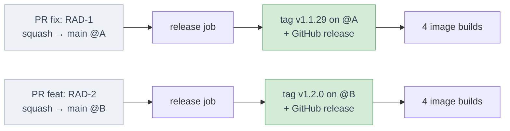
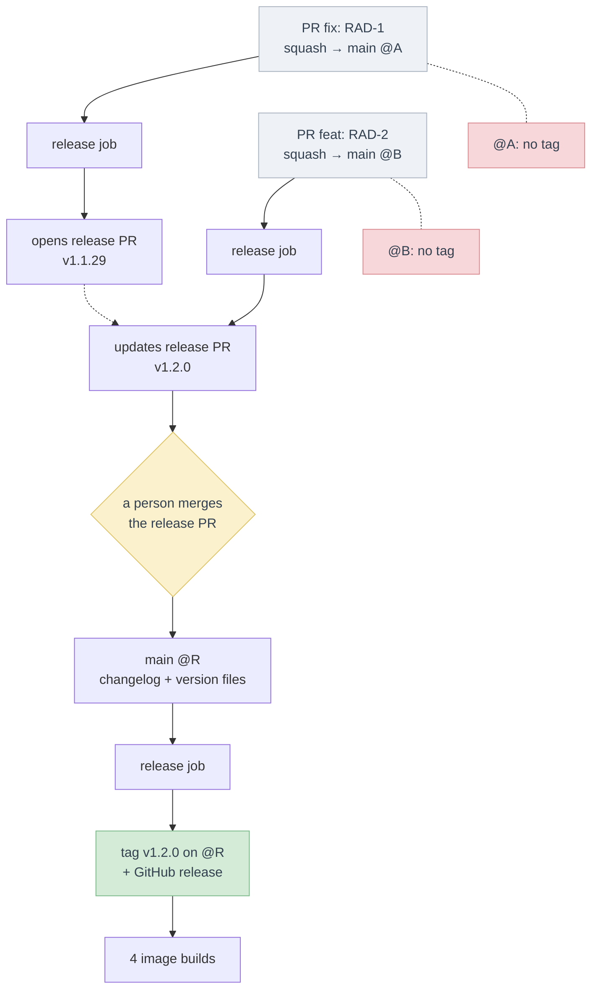

# RAD-184: Tag each ETL release from its conventional commit

## Story

- **Link:** [RAD-184](https://ferlab-crsj.atlassian.net/browse/RAD-184) (siblings: ETL QA auto-deploy, independent; ETL upgrade guide, needs the tags of this story)
- **Assigned reviewer:** TBD
- **Status:** Draft
- **Branch (all repos):** `feat/rad-184-etl-release-conventional-commits`

## Chosen approach

**Summary:** on each push to `main`, a release workflow runs [semantic-release](https://github.com/semantic-release/semantic-release). It reads the commits since the last `v*` tag, computes the next semantic version from their types, tags the pushed commit and creates the GitHub release with its notes. A GitHub App token pushes the tag, so the four image workflows start as they do for a tag created by hand. A required check validates each PR title, which becomes the squash commit subject.

### etl

- **Release tool:** semantic-release, which runs [after every successful build on the release branch](https://github.com/semantic-release/semantic-release#how-does-it-work) and tags the pushed commit. It runs with Node.js in CI only, with its commit analyzer, release notes and GitHub plugins, and no package publish. The appendix shows why release-please does not fit.
- **Version rules:** `fix` and `perf` → patch, `feat` → minor, `!` after the type or a `BREAKING CHANGE:` footer → major. `chore`, `docs`, `test`, `ci`, `refactor`, `style`, `build` and a merge commit → no release. These are the [default rules of the semantic-release commit analyzer](https://github.com/semantic-release/commit-analyzer/blob/master/lib/default-release-rules.js); the [`conventionalcommits` preset](https://github.com/conventional-changelog/conventional-changelog/blob/master/packages/conventional-changelog-conventionalcommits/src/constants.js) parses the `!` marker.
- **Tag format:** `v<major>.<minor>.<patch>`, as today. The tool starts from the latest semver tag reachable from `main` (`v1.1.28` today). The old `-rc.1` and `-prerelease` tags stay and are not on the `v1.1.*` line.
- **Token:** a GitHub App installation token ([create-github-app-token](https://github.com/actions/create-github-app-token)) pushes the tag and creates the release. A tag pushed with the default `GITHUB_TOKEN` starts no workflow ([GitHub docs](https://docs.github.com/en/actions/concepts/security/github_token)). The token is short-lived (1 h) and belongs to the organisation, not to a person. A fine-grained personal access token stays the fallback if the App cannot be created; it is tied to a person and must be rotated.
- **Image workflows:** no change. The four `build_and_push*` workflows keep their `v*` tag trigger, so a tag created by hand still works. The QA auto-deploy story adds a push-to-`main` trigger with `<short sha>-<unix timestamp>` tags next to it; the two triggers are independent.
- **Release notes:** generated from the commits since the previous tag, grouped by type, on the GitHub release of each tag. Each squash subject keeps its PR number, so the notes list the PRs of the release in merge order.
- **Concurrency:** one release run at a time, in one concurrency group with [`queue: max`](https://docs.github.com/en/actions/how-tos/write-workflows/choose-when-workflows-run/control-workflow-concurrency) (the default queue cancels a pending run). A run whose commit is no longer the head of `main` publishes nothing; the next run releases its commits (see open questions).
- **PR title check:** a new workflow on `pull_request_target` (opened, edited, reopened, synchronize) runs [action-semantic-pull-request](https://github.com/amannn/action-semantic-pull-request) with the types above, `feat`, `fix` and `perf`. It becomes a required check on `main`.
- **Docs:** the README gets a table of the commit types and the version bump of each. The ETL CLAUDE.md says that a merge to `main` creates the tag, and lists the four images (it says two today).
- **Hooks for the upgrade guide story:**
  - **Release section:** semantic-release builds the notes as ["the concatenation of each plugin output"](https://semantic-release.gitbook.io/semantic-release/usage/plugins) of the generate-notes step. The upgrade guide story adds its "Upgrade guide" section as one more plugin there (for example a [`generateNotesCmd`](https://github.com/semantic-release/exec)), with no change to the version rules.
  - **Version range:** one `vX.Y.Z` tag per release, on a commit of `main`, never moved or reused. Its aggregation between two versions can sort the tags and reject a version that does not exist.
  - **Tag = merged commit:** the release writes no file and makes no commit on `main`. So the first tag that contains a PR's commit is that PR's release. The aggregation can find the release of each note from the tags, and read the note's text from `main`, so a correction merged after the release reaches the guide.
  - **PR checks:** the title check is its own workflow, so the upgrade note check can join the same required checks.

## Modules impacted

| Module | Area | Kind of change |
|---|---|---|
| etl | CI workflows (new release workflow, new PR title check), release tool config, README, CLAUDE.md | new / modified |
| infra | GitHub organisation: one GitHub App with `contents: write` on the ETL repo; ETL repo settings (squash title, required check) | new (settings, no code) |

The portal and the MCP keep their own release process.

## Tasks

| # | Task | Component | Content | Depends on | Shippable alone? |
|---|---|---|---|---|---|
| 1 | Check the PR title | etl | PR title check workflow, allowed types | — | yes (not required until the rollout step) |
| 2 | Release on merge to `main` | etl | Release workflow and tool config, App token step, concurrency group, README commit types table, CLAUDE.md | Task 1, App secrets | yes, once the App secrets exist |

No Labels or UX task: nothing is shown to users.

## Merge and rollout order

1. GitHub org: an org admin creates the GitHub App, installs it on the ETL repo only, and stores its id and private key as ETL repo secrets. If skipped, the release workflow fails at the token step and no tag is created.
2. ETL repo settings: squash merge only, squash commit message = PR title. If skipped, a squash of one commit keeps that commit's message instead of the checked title, and a merge commit brings its inner commits to the release analysis.
3. etl: merge task 1, then mark the title check as required on `main`. If not required, a bad title can merge and its change gets no release.
4. etl: merge task 2. Its `ci:` commit creates no tag. The first `fix` or `feat` merged after it creates `v1.1.29` or `v1.2.0`.

No migration, no feature flag, no backfill: the existing tags stay as they are.

## Test strategy

| Module | How the story is proven |
|---|---|
| etl | • **AC5 (title check):** the PR of task 2 is opened with a bad title first: the check fails; then fixed: the check passes. • **AC1–AC4 (version rules):** a dry run of the release tool on the task 2 branch prints the next version for a `fix`, a `feat`, a `feat!`, a `BREAKING CHANGE:` footer and a `chore` commit, with no tag pushed. |
| QA (manual) | • **AC1/AC2, AC6, AC7:** the first `fix` or `feat` merged after task 2: the tag is on the merge commit, the four image workflows run on it and push the semver images, and the GitHub release lists the commits since `v1.1.28`. • **AC8 (two merges):** two small PRs merged within a minute: each tag exists once, the versions follow each other, no number is skipped. • **AC4:** a `docs:` or `chore:` merge creates no tag. |

## Risks and coverage

| Risk (from the story) | How it is covered |
|---|---|
| Traceability and audit | Each tag points to one commit on `main` and is created once (one release run at a time). Its GitHub release lists the commits since the previous tag, with their PR numbers. The tag push and the release are made by the GitHub App, so the audit log names the workflow, not a person's token. The upgrade guide story builds its per-release action list on these tags and release notes. |

## Frozen scope

| Module | Not covered |
|---|---|
| all | • Deploying any environment, and the `<short sha>-<unix timestamp>` image tags and Flux automation for QA (QA auto-deploy story). • Upgrade notes, their PR check, the "Upgrade guide" release section and the aggregation between two versions (upgrade guide story). • The portal and MCP release process. |
| etl | • No commitlint on local commits: only the PR title, which becomes the squash subject, is checked. • A commit pushed to `main` without a PR is tagged by the same rules, but no title check applies. • No version written in a project file (`pyproject.toml` keeps its own version); the tag is the version. • No pre-release (`-rc`) channel. • No change to the four image workflows. A tag rebuilds its images from the commit. Promoting the image digest that QA tested to the semver tag, without a rebuild, needs the QA auto-deploy story first; a separate ticket will do it if needed. |

## Open questions

| Module | Questions |
|---|---|
| story / product | • **Two merges close together:** the release tool tags only the head of `main`. If a second merge lands before the first run starts, both commits go into one release on the second commit, with the highest bump of the two. No number is skipped or reused (AC8), but the first commit gets no tag of its own (AC1–AC3 say "on that commit"). Proposal: accept, and reword the ACs to "on that commit or on a later commit of `main`". The upgrade guide story is not affected: it groups the notes by release, and both PRs are in that release. |
| etl | • **Ticket key in the title:** should the check require a `RAD-xxx` key after the type, as the hub git rule asks? Proposal: yes for `feat` and `fix`, not for `chore`, `ci` and `docs` (some bump commits have no ticket). • **Merge commits:** `main` has merge commits from PRs (#291, #295, #301). Proposal: allow squash only. Then each PR is one commit with its PR number, which the release notes and the upgrade guide's "PRs in merge order" need. Not verified: the current repo merge settings (check with an admin). |
| infra | • **App owner:** who in the radiant-network org creates and owns the GitHub App? |

## Approval

| | |
|---|---|
| Reviewer | TBD |
| Date | … |
| Plan review duration | … min |
| Decision | Approved / Approved with adjustments / Rework needed |
| Comments | … |

## Deviation log

| Date | Need found | Option A: new ticket (link) | Option B: re-approval (by whom, when) |
|---|---|---|---|
| … | … | … | … |

## Appendix: why semantic-release and not release-please

The two tools read the same conventional commits and compute the same bumps. They differ in **when** the tag is created and **on which commit**.

| | semantic-release | release-please |
|---|---|---|
| Trigger of a release | each push to `main` | the merge of a release PR, by a person |
| Commit that gets the tag | the merged commit | the release PR's commit |
| Files written to `main` | none | changelog and version files ([README](https://github.com/googleapis/release-please)) |
| AC1–AC3 ("tag on that commit, no manual step") | met | not met |

Both flows below start from `v1.1.28`, with a `fix` PR then a `feat` PR merged to `main`.

**semantic-release:** each merge gets its own tag and its own image builds.

**release-please:** "Rather than continuously releasing what's landed to your default branch, release-please maintains Release PRs" ([README](https://github.com/googleapis/release-please)). The merges only update a release PR. A person merges it, and only that commit gets a tag.

In this flow, release-please never creates `v1.1.29`, and the `fix` ships only when a person merges the release PR. That is the manual step the story removes.
