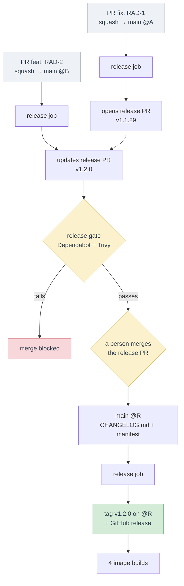
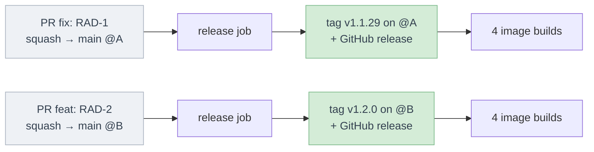

# RAD-184: Release the ETL from its conventional commits

## Story

- **Link:** [RAD-184](https://ferlab-crsj.atlassian.net/browse/RAD-184) (siblings: ETL QA auto-deploy, independent; ETL upgrade guide, needs the tags of this story)
- **Assigned reviewer:** TBD
- **Status:** Draft
- **Branch (all repos):** `feat/rad-184-etl-release-conventional-commits`

## Chosen approach

**Summary:** on each push to `main`, a release workflow runs [release-please](https://github.com/googleapis/release-please). It keeps one release PR open, with the next semantic version computed from the commit types since the last release and the changelog of these commits. When the team merges the release PR, release-please tags the release commit and creates the GitHub release. A GitHub App token creates the release PR and the tag, so the PR checks and the four image workflows start. A required check validates each PR title, which becomes the squash commit subject. A release goes to prod, so a second required check, the release gate, blocks the merge of the release PR while a high or critical vulnerability is open (Dependabot alerts, Trivy scan of the four images).

### etl

- **Release tool:** release-please, through its [GitHub Action](https://github.com/googleapis/release-please-action), with a manifest config at the repo root ([manifest releaser](https://github.com/googleapis/release-please/blob/main/docs/manifest-releaser.md)). Each release writes `CHANGELOG.md` and the version in the manifest. `pyproject.toml` keeps its static version. Not verified: which release type changes no other file (the `simple` type also keeps a version file); the PR chooses it. The appendix shows the flow and why it was chosen over semantic-release.
- **Release PR:** each push to `main` with a user-facing commit opens or updates one release PR, titled `chore(main): release <version>` ([default pattern](https://github.com/googleapis/release-please/blob/main/docs/customizing.md)). Its body is the changelog of the next release. Merging it is the release decision: one manual step, by a person.
- **Version rules:** breaking change (`!` after the type, or a `BREAKING CHANGE:` footer) → major, `feat` → minor, other user-facing commits (`fix`, `perf`, `revert`) → patch ([customizing](https://github.com/googleapis/release-please/blob/main/docs/customizing.md)). `docs`, `style`, `chore`, `refactor`, `test`, `build` and `ci` are [hidden types](https://github.com/conventional-changelog/conventional-changelog/blob/master/packages/conventional-changelog-conventionalcommits/src/constants.js): alone, they open no release PR ([source](https://github.com/googleapis/release-please/blob/main/src/strategies/base.ts): "No user facing commits found … skipping").
- **Tag format:** `v<major>.<minor>.<patch>`, as today, with `include-component-in-tag: false` ([config schema](https://github.com/googleapis/release-please/blob/main/schemas/config.json)). The manifest starts at `1.1.28`, and the config bootstraps from the commit of `v1.1.28`, so the first release is `v1.1.29` or `v1.2.0`. The old `-rc.1` and `-prerelease` tags stay.
- **Token:** a GitHub App installation token ([create-github-app-token](https://github.com/actions/create-github-app-token)), with `contents`, `issues` and `pull-requests` set to write, as the action [requires](https://github.com/googleapis/release-please-action), and `Dependabot alerts` set to read for the release gate ([App permissions](https://docs.github.com/en/rest/authentication/permissions-required-for-github-apps)). Events created with the default `GITHUB_TOKEN` start no workflow ([GitHub docs](https://docs.github.com/en/actions/concepts/security/github_token)). The token lives 1 h and belongs to the organisation, not to a person. With it:
  - the release PR runs the PR checks, so the required title check can pass and the PR can merge;
  - the tag starts the four image workflows.

  A fine-grained personal access token stays the fallback if the App cannot be created; it is tied to a person and must be rotated.
- **Image workflows:** no change. The four `build_and_push*` workflows keep their `v*` tag trigger, so a tag created by hand still works. The QA auto-deploy story adds a push-to-`main` trigger with `<short sha>-<unix timestamp>` tags next to it; the two triggers are independent.
- **Release notes:** the changelog of the release PR, grouped by type, with a link to each PR. The same text goes to `CHANGELOG.md` and to the GitHub release.
- **Concurrency:** one release run at a time, in one concurrency group. Each run rebuilds the release PR from all the commits since the last release, so a newer run that replaces a pending one loses nothing.
- **PR title check:** a new workflow on `pull_request_target` (opened, edited, reopened, synchronize) runs [action-semantic-pull-request](https://github.com/amannn/action-semantic-pull-request) with the types above. It becomes a required check on `main`. The release PR title passes it (`chore` type).
- **Release gate:** a new workflow on `pull_request`, with one job that runs only on the release PR. On the other PRs the job is skipped, and a skipped job reports "Success", so it does not block them ([GitHub docs](https://docs.github.com/en/actions/using-jobs/using-conditions-to-control-job-execution)). It becomes a required check on `main`. The job fails when:
  - the repo has an open Dependabot alert of severity `high` or `critical` ([Dependabot alerts API](https://docs.github.com/en/rest/dependabot/alerts), App token);
  - [Trivy](https://github.com/aquasecurity/trivy-action) finds a `HIGH` or `CRITICAL` vulnerability that has a fix, in one of the four images built from the release PR head with no push (`exit-code: 1`, `ignore-unfixed: true`).

  It writes the findings to the job summary. An accepted risk is a dismissed Dependabot alert (with its reason, in GitHub), or a `.trivyignore` entry merged through a reviewed PR. The job runs again each time the release PR is updated. Not verified: whether the release PR is found by its branch name or its label; the PR chooses.
- **Docs:** the README gets a table of the commit types and the version bump of each, and says how to release (merge the release PR). The ETL CLAUDE.md says the same, and lists the four images (it says two today).
- **Hooks for the upgrade guide story:**
  - **Release section:** release-please has no plugin step for the notes. The upgrade guide story adds steps to the same release job ([action outputs](https://github.com/googleapis/release-please-action)):
    - while the release PR is open, it posts the collected upgrade notes as a comment on the PR (`pr` output), so the team sees the actions before it releases;
    - when `release_created` is true, it appends the "Upgrade guide" section to the GitHub release named by `tag_name`.
  - **Version range:** one `vX.Y.Z` tag per release, on a commit of `main`, never moved or reused. Its aggregation between two versions can sort the tags and reject a version that does not exist.
  - **Release of a PR:** the first tag that contains a PR's commit is that PR's release. The aggregation can find the release of each note from the tags, and read the note's text from `main`, so a correction merged after the release reaches the guide. `CHANGELOG.md` keeps the text as it was at the release.
  - **PR checks:** the title check is its own workflow, so the upgrade note check can join the same required checks.

## Modules impacted

| Module | Area | Kind of change |
|---|---|---|
| etl | CI workflows (new release workflow, new PR title check, new release gate), release-please config and manifest, `.trivyignore`, `CHANGELOG.md`, README, CLAUDE.md | new / modified |
| infra | GitHub organisation: one GitHub App with `contents`, `issues` and `pull-requests` write and `Dependabot alerts` read on the ETL repo; ETL repo settings (squash title, Dependabot alerts on, required checks) | new (settings, no code) |

The portal and the MCP keep their own release process.

## Tasks

| # | Task | Component | Content | Depends on | Shippable alone? |
|---|---|---|---|---|---|
| 1 | Check the PR title | etl | PR title check workflow, allowed types | — | yes (not required until the rollout step) |
| 2 | Release gate | etl | Release gate workflow (Dependabot alerts, Trivy scan of the four images), empty `.trivyignore`, README section on how to accept a risk | App secrets | yes (skipped until a release PR exists) |
| 3 | Release PR and tag | etl | Release workflow, release-please config and manifest, App token step, concurrency group, README release section, CLAUDE.md | Tasks 1 and 2, App secrets | yes, once the App secrets exist |

No Labels or UX task: nothing is shown to users.

## Merge and rollout order

1. GitHub org: an org admin creates the GitHub App, installs it on the ETL repo only, and stores its id and private key as ETL repo secrets. If skipped, the release workflow fails at the token step: no release PR, no tag.
2. ETL repo settings: squash merge only, squash commit message = PR title, Dependabot alerts on. If skipped, a squash of one commit keeps that commit's message instead of the checked title, a merge commit brings its inner commits to the release analysis, and the gate sees no alert.
3. etl: merge task 1, then mark the title check as required on `main`. If not required, a bad title can merge and its change is left out of the release PR.
4. etl: merge task 2, then mark the release gate as required on `main`. If skipped, the first release PR can merge with an open vulnerability.
5. etl: merge task 3. Its `ci:` commit opens no release PR. The first `fix` or `feat` merged after it opens the release PR for `v1.1.29` or `v1.2.0`.

No migration, no feature flag, no backfill: the existing tags stay as they are, and `CHANGELOG.md` starts at the first release-please release.

## Test strategy

| Module | How the story is proven |
|---|---|
| etl | • **Release gate:** on the task 2 branch, the job is run by hand against a temporary commit that pins a library version with a known high vulnerability: the Trivy step fails and names it; without the commit, it passes. The Dependabot step prints the count of open high and critical alerts, checked against the repo's Security tab. • **AC5 (title check):** the PR of task 3 is opened with a bad title first: the check fails; then fixed: the check passes. • **AC1–AC4 (version rules):** the release-please CLI with [`--dry-run`](https://github.com/googleapis/release-please/blob/main/docs/cli.md) on the task 3 branch reports the release PR it would open for a `fix`, a `feat`, a `feat!`, a `BREAKING CHANGE:` footer and a `chore` commit, with no PR opened. |
| QA (manual) | • **AC1/AC2:** the first `fix` or `feat` merged after task 3 opens the release PR with the right version; its checks run, the release gate included. • **Release gate:** on a normal PR, the gate shows as skipped and the PR can merge; on the release PR, it runs, and GitHub blocks the merge while it fails. • **AC4:** a `docs:` or `chore:` merge alone opens no release PR and does not change its version. • **AC6, AC7:** the release PR is merged: the tag is on the release commit, the four image workflows run on it and push the semver images, and the GitHub release lists the PRs since `v1.1.28`. • **AC8 (two merges):** two small PRs merged within a minute: the release PR lists both, and its merge creates one tag. |

## Risks and coverage

| Risk (from the story) | How it is covered |
|---|---|
| Traceability and audit | Each tag points to one release commit on `main` and is created once, when a person merges the release PR. The merge records who released and when. The GitHub release and `CHANGELOG.md` list the PRs since the previous tag. The tag and the release are made by the GitHub App, so the audit log names the workflow, not a person's token. The upgrade guide story builds its per-release action list on these tags. |
| A known vulnerability reaches prod (added: a release goes to prod) | The release gate is a required check on the release PR: no release while a high or critical Dependabot alert is open or Trivy finds a fixable high or critical vulnerability in an image. Each accepted risk leaves a trace: the dismissal reason in GitHub, or the reviewed `.trivyignore` PR. Gaps: see the open questions (a gate result goes stale; the tag rebuilds the images). |

## Frozen scope

| Module | Not covered |
|---|---|
| all | • Deploying any environment, and the `<short sha>-<unix timestamp>` image tags and Flux automation for QA (QA auto-deploy story). Merging the release PR deploys nothing. • Upgrade notes, their PR check, the "Upgrade guide" sections and the aggregation between two versions (upgrade guide story). • The portal and MCP release process. |
| etl | • No commitlint on local commits: only the PR title, which becomes the squash subject, is checked. • A commit pushed to `main` without a PR goes into the release PR by the same rules, but no title check applies. • No version in `pyproject.toml`: the manifest and the tag hold it. • No pre-release (`-rc`) channel, no maintenance branch for a hotfix on an older release. • No vulnerability scan on the other PRs, and no upload of the Trivy results to the Security tab: the gate writes them to the job summary only. • No change to the four image workflows. A tag rebuilds its images from the commit. Promoting the image digest that QA tested to the semver tag, without a rebuild, needs the QA auto-deploy story first; a separate ticket will do it if needed. |

## Open questions

| Module | Questions |
|---|---|
| story / product | • **ACs to reword for the release PR:** the story asks for a tag on each merge, with no manual step. Proposal, to apply in Jira after your go-ahead: &nbsp;&nbsp;◦ Intent: "each merge to `main` updates a release PR, and merging it creates the right semantic version tag". &nbsp;&nbsp;◦ AC1–AC3: "the release PR proposes the patch / minor / major version; when it is merged, the tag exists on the release commit". &nbsp;&nbsp;◦ AC4: "a `chore`, `docs` … merge alone opens no release PR and does not change its version". &nbsp;&nbsp;◦ AC8: "two merges close together both go into the release PR; its merge creates one tag". &nbsp;&nbsp;◦ New AC9: "the release PR cannot merge while a high or critical Dependabot alert is open, or Trivy finds a fixable high or critical vulnerability in one of the four images". • **Who merges the release PR, and when?** Proposal: the ETL lead, when the team wants a release. The release is the version that goes to prod, but merging it deploys nothing (deploy stays per environment). |
| etl | • **Ticket key in the title:** should the check require a `RAD-xxx` key after the type, as the hub git rule asks? Proposal: yes for `feat` and `fix`, not for `chore`, `ci` and `docs` (the release PR and some bump commits have no ticket). • **Merge commits:** `main` has merge commits from PRs (#291, #295, #301). Proposal: allow squash only. Then each PR is one commit with its PR number, which the changelog and the upgrade guide's "PRs in merge order" need. Not verified: the current repo merge settings (check with an admin). • **Gate threshold:** high and critical only, and Trivy ignores vulnerabilities with no fix? Proposal: yes. A Dependabot alert with no patch still blocks until a person dismisses it with a reason. • **Stale gate result:** the gate runs when the release PR changes. An alert published later, while the PR waits, does not fail it. Proposal: the person who merges re-runs the gate job first (written in the README). • **Rebuild at the tag:** the base images are pinned by tag, not by digest (`apache/airflow:2.10.5-python3.12`, `python:3.12`, `python:3.12-slim`, `amazonlinux:2023`). So the tag build can pull a newer base than the scanned one. Proposal: accept for now; the digest promotion ticket (frozen scope) removes the gap. • **Who accepts a risk?** Proposal: the ETL lead dismisses alerts and approves `.trivyignore` PRs. |
| infra | • **App owner:** who in the radiant-network org creates and owns the GitHub App? • **Dependabot alerts:** are they on for the ETL repo? Not verified (needs a repo admin). |

## Approval

| | |
|---|---|
| Reviewer | TBD |
| Date | … |
| Plan review duration | … min |
| Decision | Approved / Approved with adjustments / Rework needed |
| Comments | … |

## Deviation log

| Date | Need found | Option A: new ticket (link) | Option B: re-approval (by whom, when) |
|---|---|---|---|
| … | … | … | … |

## Appendix: why release-please and not semantic-release

The two tools read the same conventional commits and compute the same bumps. They differ in **when** the tag is created and **on which commit**.

| | release-please | semantic-release |
|---|---|---|
| Trigger of a release | the merge of the release PR, by a person | each push to `main` |
| Commit that gets the tag | the release commit | each merged commit |
| Files written to `main` | `CHANGELOG.md` and the manifest | none |
| Review before the release | the release PR shows the version, the changelog and, with the upgrade guide story, the upgrade notes | none: the release happens at the merge |
| Gate before the release | the required checks of the release PR (release gate) | none: a failed check after the merge cannot stop the tag |

release-please was chosen because the release PR is one place where the team sees what the next release holds, with its upgrade actions and its vulnerabilities, and decides when to release. The cost is one manual step, the merge of the release PR, and one release commit per release on `main`.

Both flows below start from `v1.1.28`, with a `fix` PR then a `feat` PR merged to `main`.

**release-please (chosen):** "Rather than continuously releasing what's landed to your default branch, release-please maintains Release PRs" ([README](https://github.com/googleapis/release-please)). The merges update the release PR. A person merges it, and that commit gets the tag.

**semantic-release (not chosen):** each merge gets its own tag and its own image builds, with no review step.

