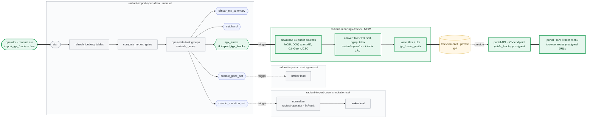

# RAD-30: Show CNV, signal and reference tracks in IGV

## Story

- **Link:** [RAD-30](https://ferlab-crsj.atlassian.net/browse/RAD-30)
- **Assigned reviewer:** Jeremy Costanza, Jean-Philippe Thibert
- **Status:** Draft
- **Branch (all repos):** `feat/rad-30`
- **Context (SJRA-1963):** that ticket lets Radiant import the per-sequencing files that Qlin produces. It sets the codes that this plan reads:
  - Qlin `IGV` files (`*.seg.bw`, `*.baf.bw`) map to `igv` / `bw` or `bed`. ROH (`*.roh.bed`) gets no type of its own: it is filed as `igv` / `bed`.
  - Within one data type, the format tells files apart. Here Seg and BAF share `igv` / `bw`, so this plan adds the file name suffix (see "Which files").
  - Files of one type that come from different tasks are told apart by the task type (e.g. `exomiser_cnv`). This plan uses the same rule to pick the CNV VCF of the variant-calling task.
  - It adds `alirpg` (masked CRAM, `*.masked.cram`). This plan keeps the Reads track on `alignment` only.

## Chosen approach

**Summary:** the IGV endpoint `/{tenant}/igv/{case_id}` returns the CNV, Seg, BAF, ROH and capture targets files of the case next to the alignments, already presigned and named. The frontend loads each track on its own, so a failing track does not block the others, and adds a Tracks menu for the public reference tracks. A new ETL job builds the public tracks, as Qlin does, into a private bucket; the same endpoint returns them presigned.

- **portal (backend)**
  - **Today:** the endpoint keeps only `alignment` / `cram`+`crai` output documents. It names them `Reads: <sample> <role>` (germline) or `Reads: <sample> <histology>` (somatic), proband or tumor first. The response has one field, `alignment`.
  - **Which files:** output documents of the case's sequencing experiments:

    | Track | Data type | Format | File name ends with | Returned for |
    |---|---|---|---|---|
    | CNVs | `gcnv` or `scnv` | `vcf` + `tbi` | — | each sample, variant-calling tasks only |
    | Reads (no change) | `alignment` | `cram` + `crai` | — | each member |
    | Seg | `igv` | `bw` | `.seg.bw` | each member |
    | BAF | `igv` | `bw` | `.baf.bw` | each member |
    | ROH | `igv` | `bed` | `.roh.bed` | each member |
    | Capture targets | `igv` | `bed` | `_targets.bed` | proband (or tumor) only, once |

    - CNVs: germline samples and the normal of a tumor-normal case have a `gcnv`; the tumor has an `scnv` (as in Qlin). The backend takes whichever the sample has.
    - The ETL's CNV annotation task also writes a `gcnv` / `vcf`, but one per family with no index. It is excluded, as the ETL does when it reads CNV VCFs.
    - Seg and BAF share their codes, and so do ROH and capture targets. The backend tells them apart by the suffix of the document name, from the story's examples. An `igv` file with another name gives no track. The codes stay as they are, as SJRA-1963 expects for ROH.
  - **Names:** same rule as the Reads tracks: `CNVs: S123 proband`, `Seg: …`, `BAF: …`, `ROH: …`. Somatic labels stay the `histology_code` value (`tumoral` / `normal`), as for the Reads tracks today.
  - **Order:** members in the existing order (proband or tumor first). The frontend applies the per-member order of the story.
  - **Access:** same as today: tenant action `can_search_case`, StarRocks read under the existing connection, every URL presigned. No change (see frozen scope).
  - **Contract:** new arrays next to `alignment` in `IGVTracks`: `cnv`, `seg`, `baf`, `roh`, `capture_targets` (at most one item). Same item shape as `alignment` (`IGVTrackEnriched`); bw and bed items have no index URL. New field `sequencing_experiment_id` on each item, so the frontend groups the tracks of one sample (a tumor and its normal have the same patient). Additive; OpenAPI and TS/Python clients regenerated.
  - **Public tracks:** new field `public_tracks`: one entry per public file (11), keyed by a fixed file id (e.g. `clinvar`, `dgv`, `clingen_region`), with presigned `url` and `indexURL` and their expiry, like the case tracks.
    - The backend builds each URL from a new setting, the S3 prefix of the tracks (env var, like `S3_PRESIGNED_URL_EXPIRE`), plus the file name that the ETL job writes. The ETL owns the file names; the backend list must match them.
    - Presigning is a local signature, with no S3 call. The URLs expire like the CRAM URLs (60 min by default).
    - When the setting is empty, `public_tracks` is empty and the Tracks menu shows nothing. This keeps the backend deployable before the bucket exists.
- **portal (frontend)**
  - **IGV component rewrite:** today every track goes to `createBrowser`, so one failing track fails the whole browser; the browser is never removed (one leak per dialog opening); the `loadTrack` type is wrong (one config, not an array).
    - igv.js comes from npm (pinned `igv` package with its own types), not from the jsDelivr script loaded in the `<head>` of every page. The portal renders on the server (`ssr: true`), so igv is imported on the client only, when the dialog opens.
    - The browser is created with the reference and gene tracks only, and removed when the dialog closes. Creation is safe under React StrictMode (double mount), with no global flag. Case tracks are loaded into it afterwards.
  - **Case tracks:** per member, in this order: CNVs, Reads, Seg, BAF, ROH. The capture targets track sits under the RefSeq gene track.
  - **Formats:** CNVs as a [variant track](https://igv.org/doc/igvjs/tracks/Variant-Track/). Seg and BAF as [wig tracks](https://igv.org/doc/igvjs/tracks/Wig-Track/) (bigWig). ROH and targets as [annotation tracks](https://igv.org/doc/igvjs/tracks/Annotation-Track/) (BED).
  - **CNV colors:** gain blue, loss red, the same in every CNV track. In DRAGEN CNV VCFs, `SVTYPE` is always `CNV`; gain and loss are in `ALT` (`<DUP>` / `<DEL>`). The igv.js `colorBy` option reads an INFO field only, so the color needs a color function on `ALT` (not verified, see open questions).
  - **Load:** all case tracks load in parallel, one `loadTrack` promise each ([Browser API](https://igv.org/doc/igvjs/Browser-API/)), awaited together (`Promise.allSettled`). Each track carries an explicit `order`, so the layout does not depend on which file answers first. A rejected track is removed and listed in a message that names it; the others stay.
  - **Large families:** every member's tracks show by default, as AC1 asks. A request cap protects the browser: CRAM requests are throttled to 20 in flight (plain queue, no abort), installed before igv loads.
  - **chrM:** the risk is zooming out, not the opening window (±100 bp today). chrM is very deep on WGS, and the default alignment `visibilityWindow` (30 kb) is larger than chrM (16,569 bp), so a zoomed-out view fetches every CRAM slice of every member.
    - At load, each alignment track counts its chrM slices in its CRAM index. Sparse (exome) tracks stay unrestricted.
    - On each locus change, dense tracks on chrM get a `visibilityWindow` from a slice budget shared between them. igv.js fetches three screens (one on each side of the view), so the window is a third of what the budget allows, and never below 500 bp. Off chrM, it goes back to 30 kb. The budget starts at the Qlin value and is tuned on a deep WGS trio on QA.
    - Dense chrM tracks also get a sampling depth of 100, set on the track config (igv.js reads it there).
    - A message tells the user when the window was reduced, and why.
  - **Expiry:** all URLs come from the IGV endpoint and expire together. When they expire, the dialog fetches the endpoint again, so panning or a track switched on later does not fail with 403.
    - A loaded track keeps the URL it was created with, so the new URLs must reach it. Proposal: give each track a URL function that returns the latest presigned URL. igv.js resolves a function URL in its loader at each request, but some readers may keep the first value (CRAM not checked, see open questions). Fallback: reload the loaded tracks at the same locus.
  - **Tracks menu:** a menu in the IGV dialog switches the public tracks on and off (`loadTrack`, then removal by track id with `findTracks`: track names are not unique, e.g. a patient with WES and WGS). The dialog receives its context (SNV or CNV), which sets the list and the defaults of the story. The track URLs come from `public_tracks` in the IGV response; the frontend keeps the names, contexts, defaults and colors, and maps them to the file ids (ClinGen gene and region files give two tracks each). ClinGen tracks are colored by evidence level with `colorBy` on the GFF3 attribute ([Annotation Track](https://igv.org/doc/igvjs/tracks/Annotation-Track/)). The track config is written for Radiant: only the ClinGen palettes are reused from Qlin.
  - **Reference genome:** no change. Radiant already uses `hg38_1kg` ("Human (hg38 1kg/GATK)") and the igv.org RefSeq track, the same baseline as Qlin.
- **etl**
  - **Job:** new DAG `radiant-import-igv-tracks`, a port of Qlin's `etl_import_igv`. It downloads the 11 public files (ClinVar, ClinVar SVs, DGV, gnomAD SV and CNV v4.1, ClinGen gene and region dosage, segmental duplications, RepeatMasker, simple repeats, self chain). It converts ClinGen and the UCSC tables to GFF3, sorts, bgzips and tabix-indexes them, and writes each file and its `.tbi` under one prefix.
  - **When:** once per environment, not per case: the files are the same for every case. No schedule, like Qlin's DAG (`schedule=None`). Rerun by hand to take a new upstream release.
  - **Entry point:** `import_open_data` gets an optional branch that triggers the DAG, next to the COSMIC branches and with the same mechanism. The IGV DAG also runs alone (e.g. to retry a failed download).
    - New param `import_igv_tracks` (boolean, optional, default `false`). Off by default because `reannotate_open_data` triggers `import_open_data`, and must not rebuild the files each time. Example: `{"import_igv_tracks": true}`.
  - **Run:** the conversion runs as a task on the radiant-operator image (ECS or Kubernetes), like the COSMIC normalize task. The image installs only the Debian `bcftools` package today, which does not bring `bgzip` and `tabix`. Task 6 adds the Debian [`tabix`](https://packages.debian.org/bookworm/amd64/tabix/filelist) package, which holds both.
  - **Run config (IGV DAG):** `igv_tracks_prefix` (string, optional; S3 prefix to write to; defaults to an environment variable, like `reference_fasta_filepath`). Example: `{"igv_tracks_prefix": "s3://<tracks bucket>/igv/"}`. A rerun replaces the files with the latest upstream versions.
  - **Access:** the DAG writes with the ETL's own AWS role. The browser reads the files through URLs that the portal API presigns with its own role.
- **infra**
  - **Bucket:** private, per environment (QA, prod). The ETL role writes the `igv/` prefix; the portal API role reads it. No public access.
  - **CORS:** `GET` / `HEAD` from the portal origin, with the range headers exposed, as the existing portal CORS rule of the QA buckets.
  - **Portal API setting:** the tracks prefix in the portal API deployment.

## Modules impacted

| Module | Area | Kind of change |
|---|---|---|
| portal (backend) | IGV repository query and track builder, IGV response type, public tracks setting and presigning, OpenAPI spec, generated TS and Python clients | new / modified |
| portal (frontend) | IGV component rewrite (npm igv, client-only import, browser lifecycle), IGV dialog (track loading, ordering, colors, errors, chrM, URL refresh), CRAM request throttle, new Tracks menu and its track config, igv script removed from the root page, EN/FR translations | new / modified |
| etl | public IGV tracks import DAG and its conversion task, new branch in `import_open_data`, DAG tests, docs | new / modified |
| infra | tracks bucket with CORS, ETL write and API read access (QA, prod), portal API setting | new / modified |

## Tasks

| # | Task | Component | Content | Depends on | Shippable alone? |
|---|---|---|---|---|---|
| 1 | Case file tracks in the IGV API | portal (backend) | CNV, Seg, BAF, ROH and targets selection, names, new arrays and `sequencing_experiment_id`, OpenAPI + clients, integration tests | — | yes (additive) |
| 2 | Public tracks in the IGV API | portal (backend) | `public_tracks` field, tracks prefix setting, presigning, OpenAPI + clients, tests | — | yes (empty until the setting is set) |
| 3 | Labels | portal (frontend) | EN/FR: track prefixes, Tracks menu entries, failed-track message, chrM message | — | yes |
| 4 | Case tracks in IGV | portal (frontend) | IGV component rewrite (npm igv, client-only import, browser created with reference tracks only and removed on close); per-member order, targets under genes, CNV colors, parallel load with failure message, CRAM throttle, chrM density rule, URL refresh on expiry | Tasks 1, 3 | yes once 1 is deployed |
| 5 | Tracks bucket | infra | Private bucket, CORS, ETL role write and API role read on `igv/` (QA, prod); tracks prefix setting in the portal API deployment | — | yes (no reader yet) |
| 6 | Public tracks import | etl | DAG `radiant-import-igv-tracks`, conversion task on the radiant-operator image (plus the `tabix` package), `import_igv_tracks` branch in `import_open_data`, DAG tests, docs | — | yes (manual trigger) |
| 7 | Tracks menu | portal (frontend) | Menu, SNV/CNV defaults, ClinGen colors, mapping of the file ids, removal by track id | Tasks 2, 3, 4 | yes (empty until 5 and 6 run) |
| 8 | UX (tentative) | UX | Place of the Tracks menu and of the failed-track message in the IGV dialog. Kept only if the reuse of an existing menu component is not enough | — | yes (no code) |

## Merge and rollout order

1. infra: task 5 (QA, then prod). Without the bucket, the ETL job has nowhere to write; without the read grant, the presigned URLs return 403.
2. etl: deploy task 6, then run `import_open_data` with `{"import_igv_tracks": true}` once per environment. Without it, the presigned URLs point to missing files.
3. portal backend: tasks 1 and 2, then set the tracks prefix setting after step 2. Until then, `public_tracks` is empty.
4. portal frontend: tasks 3, 4 and 7 after step 3, in each environment.

No migration, no backfill, no feature flag. Files that a case does not have give no track. The public tracks are refreshed by a manual rerun of the job.

## Test strategy

| Module | How the story is proven |
|---|---|
| portal (backend) | • **AC1:** integration tests with a germline family fixture holding `gcnv` vcf+tbi, `igv` bw (seg, baf) and bed (roh) documents: each member gets the right tracks and names; the family-level annotation VCF is excluded; an `igv` file with an unknown suffix gives no track.<br>• **AC2:** targets returned once, from the proband.<br>• **AC3:** somatic TN fixture: tumor (`scnv`) and normal (`gcnv`) CNV tracks, labeled `tumoral` and `normal`. |
| portal (frontend) | • **AC1, AC2:** Vitest on the track list builder: order per member, targets under genes.<br>• **AC4:** Vitest on the Tracks menu config: lists and defaults for the SNV and CNV contexts.<br>• **AC5:** Vitest with one rejected track load: the others load and the message names the failed track.<br>• **AC6:** Vitest on the chrM window rule (dense and sparse tracks, on and off chrM) and on the request throttle (never more than 20 in flight). |
| etl | • **AC4:** DAG tests: task graph and params of the IGV DAG; the `import_open_data` branch triggers it only when `import_igv_tracks` is true; unit tests on the ClinGen and UCSC to GFF3 conversions, on small extracts. |
| QA (manual) | • Germline trio and a large family on QA: tracks, names, order, colors (AC1, AC2, AC6).<br>• SNV on chrM, then zoom out to the whole of chrM, on a WGS trio (AC6).<br>• Dialog left open more than 60 min, then pan (URL refresh).<br>• Somatic TN case (AC3).<br>• Tracks menu from an SNV; CNV context once the CNV entry point exists (AC4).<br>• A case with one broken file URL (AC5). |

## Risks and coverage

The story checks no particular business risk. The plan adds new presigned file links behind `can_search_case` only, like the existing CRAM links. The story moves that gap to a separate ticket (see frozen scope). The public tracks hold public data only, so presigning them behind the same check adds no exposure.

## Frozen scope

| Module | Not covered |
|---|---|
| all | • Opening IGV from the CNV table and from the gene coverage table: separate ticket. Until then, the CNV context of the Tracks menu has no entry point.<br>• IGV in the variant entity side panels stays disabled.<br>• Access control of the IGV links (`can_search_case` vs the org-scoped `can_download_file`): separate ticket.<br>• Classification of ROH files as `igv` / `bed`: SJRA-1963. |
| portal (backend) | • No new data type or format code.<br>• No change to the alignment track selection: masked CRAMs (`alirpg`) give no track.<br>• No rename of the somatic labels: `tumoral` stays, where the story says "tumor". |
| portal (frontend) | • No change to the reference genome or the gene track.<br>• No saved track preferences: the menu resets to the defaults at each opening. |
| etl | • No registration of Seg, BAF, ROH or targets files: the ETL registers none of them today (only SNV, CNV, Exomiser and QC outputs).<br>• No schedule for `radiant-import-igv-tracks`, no version tracking of the public files: manual rerun only.<br>• The public tracks are files only: no StarRocks or Iceberg table. |

## Open questions

| Module | Questions |
|---|---|
| story / product | • **Source of the case files:** the Qlin import of SJRA-1963 registers them; the ETL does not, and no seeds or fixtures hold any. Are they on QA today? Check that their names end with the suffixes above: a file with another name shows no track, with no error. |
| infra | • **Bucket:** a new bucket, or an `igv/` prefix in a bucket that the portal API already reads (with its CORS rule)? Proposal: the existing bucket, since nothing is public any more. |
| portal (backend) | • **Somatic CNVs:** confirm on a QA tumor-normal case: `scnv` on the tumor, `gcnv` on the normal (as in Qlin). |
| portal (frontend) | • **CNV color on `ALT`:** check that the igv.js version picked from npm accepts a color function on a variant track. Fallback: color on an INFO field added by the pipeline.<br>• **URL refresh:** check that a function URL is resolved at each request for CRAM, bigWig, VCF and GFF3 tracks in the picked igv.js version. If not, the refresh reloads the tracks.<br>• **UX task (task 8):** needed? |

## Approval

| | |
|---|---|
| Reviewer | Jeremy Costanza, Jean-Philippe Thibert |
| Date | … |
| Plan review duration | … min |
| Decision | Approved / Approved with adjustments / Rework needed |
| Comments | … |

## Deviation log

| Date | Need found | Option A: new ticket (link) | Option B: re-approval (by whom, when) |
|---|---|---|---|
| … | … | … | … |

## Appendix

### A. Sample `GET /{tenant}/igv/{case_id}` response

Germline trio, shortened to the proband (`S123`) and the mother (`S124`). The mother has no Seg file, so she has no `seg` item. Presigned URLs are shortened. New fields are `sequencing_experiment_id`, the arrays after `alignment`, and `public_tracks` (shortened to 2 of its 11 entries).

```json
{
  "alignment": [
    {
      "sequencing_experiment_id": 101,
      "patient_id": 1,
      "family_role": "proband",
      "sex": "male",
      "type": "alignment",
      "format": "cram",
      "url": "https://<bucket>.s3.amazonaws.com/S123.cram?X-Amz-Signature=…",
      "urlExpireAt": 1791480000,
      "indexURL": "https://<bucket>.s3.amazonaws.com/S123.cram.crai?X-Amz-Signature=…",
      "indexURLExpireAt": 1791480000,
      "name": "Reads: S123 proband"
    },
    {
      "sequencing_experiment_id": 102,
      "patient_id": 2,
      "family_role": "mother",
      "sex": "female",
      "type": "alignment",
      "format": "cram",
      "url": "https://<bucket>.s3.amazonaws.com/S124.cram?X-Amz-Signature=…",
      "urlExpireAt": 1791480000,
      "indexURL": "https://<bucket>.s3.amazonaws.com/S124.cram.crai?X-Amz-Signature=…",
      "indexURLExpireAt": 1791480000,
      "name": "Reads: S124 mother"
    }
  ],
  "cnv": [
    {
      "sequencing_experiment_id": 101,
      "patient_id": 1,
      "family_role": "proband",
      "sex": "male",
      "type": "gcnv",
      "format": "vcf",
      "url": "https://<bucket>.s3.amazonaws.com/S123.cnv.vcf.gz?X-Amz-Signature=…",
      "urlExpireAt": 1791480000,
      "indexURL": "https://<bucket>.s3.amazonaws.com/S123.cnv.vcf.gz.tbi?X-Amz-Signature=…",
      "indexURLExpireAt": 1791480000,
      "name": "CNVs: S123 proband"
    }
  ],
  "seg": [
    {
      "sequencing_experiment_id": 101,
      "patient_id": 1,
      "family_role": "proband",
      "sex": "male",
      "type": "igv",
      "format": "bw",
      "url": "https://<bucket>.s3.amazonaws.com/S123.seg.bw?X-Amz-Signature=…",
      "urlExpireAt": 1791480000,
      "indexURL": "",
      "indexURLExpireAt": 0,
      "name": "Seg: S123 proband"
    }
  ],
  "baf": [
    {
      "sequencing_experiment_id": 102,
      "patient_id": 2,
      "family_role": "mother",
      "sex": "female",
      "type": "igv",
      "format": "bw",
      "url": "https://<bucket>.s3.amazonaws.com/S124.hard-filtered.baf.bw?X-Amz-Signature=…",
      "urlExpireAt": 1791480000,
      "indexURL": "",
      "indexURLExpireAt": 0,
      "name": "BAF: S124 mother"
    }
  ],
  "roh": [
    {
      "sequencing_experiment_id": 101,
      "patient_id": 1,
      "family_role": "proband",
      "sex": "male",
      "type": "igv",
      "format": "bed",
      "url": "https://<bucket>.s3.amazonaws.com/S123.roh.bed?X-Amz-Signature=…",
      "urlExpireAt": 1791480000,
      "indexURL": "",
      "indexURLExpireAt": 0,
      "name": "ROH: S123 proband"
    }
  ],
  "capture_targets": [
    {
      "sequencing_experiment_id": 101,
      "patient_id": 1,
      "family_role": "proband",
      "sex": "male",
      "type": "igv",
      "format": "bed",
      "url": "https://<bucket>.s3.amazonaws.com/S123.HyperExomeV2_combined_targets.bed?X-Amz-Signature=…",
      "urlExpireAt": 1791480000,
      "indexURL": "",
      "indexURLExpireAt": 0,
      "name": "Capture targets"
    }
  ],
  "public_tracks": {
    "clinvar": {
      "url": "https://<tracks bucket>.s3.amazonaws.com/igv/clinvar.vcf.gz?X-Amz-Signature=…",
      "urlExpireAt": 1791480000,
      "indexURL": "https://<tracks bucket>.s3.amazonaws.com/igv/clinvar.vcf.gz.tbi?X-Amz-Signature=…",
      "indexURLExpireAt": 1791480000
    },
    "clingen_region": {
      "url": "https://<tracks bucket>.s3.amazonaws.com/igv/ClinGen_region_curation_list_GRCh38.sorted.gff3.gz?X-Amz-Signature=…",
      "urlExpireAt": 1791480000,
      "indexURL": "https://<tracks bucket>.s3.amazonaws.com/igv/ClinGen_region_curation_list_GRCh38.sorted.gff3.gz.tbi?X-Amz-Signature=…",
      "indexURLExpireAt": 1791480000
    }
  }
}
```

### B. Where the public tracks DAG fits

Green: new. Grey: existing, unchanged. Blue: existing optional branches of `import_open_data`. Initialization path: one manual run per environment.



### C. New tracks and their origin

18 new kinds of track: 5 from the case files, 13 public. A family of *n* members gets 4*n* + 1 case tracks (trio: 13), next to its *n* existing Reads tracks.

**Case tracks** (from the IGV endpoint, presigned URLs)

| Track | Shown for | Document (data type / format) | Origin |
|---|---|---|---|
| CNVs | each sample | `gcnv` or `scnv` / `vcf` + `tbi` | Output of the variant-calling task of the sample (DRAGEN CNV VCF) |
| Seg | each member | `igv` / `bw`, `*.seg.bw` | Qlin case file, imported as `igv` (SJRA-1963) |
| BAF | each member | `igv` / `bw`, `*.baf.bw` | Qlin case file, imported as `igv` (SJRA-1963) |
| ROH | each member | `igv` / `bed`, `*.roh.bed` | Qlin case file, imported as `igv` (SJRA-1963) |
| Capture targets | once, proband or tumor | `igv` / `bed`, `*_targets.bed` | Qlin case file, imported as `igv` (SJRA-1963) |

**Public tracks** (Tracks menu, built by `radiant-import-igv-tracks` into the tracks bucket, returned presigned in `public_tracks`)

| Track | Context | On by default | File | Upstream source |
|---|---|---|---|---|
| ClinVar | SNV | no | `clinvar.vcf.gz` | [NCBI ClinVar, VCF GRCh38](https://ftp.ncbi.nlm.nih.gov/pub/clinvar/vcf_GRCh38/) |
| DGV | CNV | yes | `DGV_GS_hg38.cleaned.sorted.gff3.gz` | [DGV gold standard, hg38](https://dgv.tcag.ca/dgv/docs/DGV.GS.hg38.gff3) |
| ClinVar SVs | CNV | yes | `nstd102.GRCh38.variant_call.vcf.gz` | [NCBI dbVar, study nstd102](https://ftp.ncbi.nlm.nih.gov/pub/dbVar/data/Homo_sapiens/by_study/vcf/) |
| ClinGen region haploinsufficiency | CNV | yes | `ClinGen_region_curation_list_GRCh38.sorted.gff3.gz` | ClinGen region dosage, GRCh38 (`ftp://ftp.clinicalgenome.org/ClinGen_region_curation_list_GRCh38.tsv`) |
| ClinGen region triplosensitivity | CNV | yes | same file as above | same |
| gnomAD SV v4.1 | CNV | no | `gnomad.v4.1.sv.sites.vcf.gz` | [gnomAD 4.1 genome SV](https://storage.googleapis.com/gcp-public-data--gnomad/release/4.1/genome_sv/) |
| gnomAD CNV v4.1 | CNV | no | `gnomad.v4.1.cnv.all.vcf.gz` | [gnomAD 4.1 exome CNV](https://storage.googleapis.com/gcp-public-data--gnomad/release/4.1/exome_cnv/) |
| ClinGen gene haploinsufficiency | CNV | no | `ClinGen_gene_curation_list_GRCh38.sorted.gff3.gz` | ClinGen gene dosage, GRCh38 (`ftp://ftp.clinicalgenome.org/ClinGen_gene_curation_list_GRCh38.tsv`) |
| ClinGen gene triplosensitivity | CNV | no | same file as above | same |
| Segmental duplications | CNV | no | `hg38.genomicSuperDups.gff3.gz` | [UCSC `genomicSuperDups`](https://hgdownload.soe.ucsc.edu/goldenPath/hg38/database/genomicSuperDups.txt.gz) |
| RepeatMasker | CNV | no | `hg38.rmsk.gff3.gz` | [UCSC `rmsk`](https://hgdownload.soe.ucsc.edu/goldenPath/hg38/database/rmsk.txt.gz) |
| Simple repeats | CNV | no | `hg38.simpleRepeat.gff3.gz` | [UCSC `simpleRepeat`](https://hgdownload.soe.ucsc.edu/goldenPath/hg38/database/simpleRepeat.txt.gz) |
| Self chain | CNV | no | `hg38.chainSelf.gff3.gz` | [UCSC `chainSelf`](https://hgdownload.soe.ucsc.edu/goldenPath/hg38/database/chainSelf.txt.gz) |

File names and sources are those of Qlin's `etl_import_igv`. Each file has its `.tbi` next to it.
